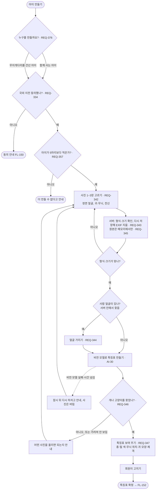

# FL-151 사진을 올려 특징표 만들기

Serves: REQ-342, REQ-343, REQ-344, REQ-345, REQ-346, REQ-347, REQ-357, REQ-376, REQ-334
Screens: SCR-140, SCR-142, SCR-143
Context: CTX-022

- 처음 고른 모드(함께 사는 아이, 무지개다리를 건넌 아이)가 캐릭터의 첫 모드예요. 회원이 직접 고른 것이라 REQ-376을 지켜요.
- 가린 사진은 캐릭터 시트가 만들어지면 지워요. 결제하지 않으면 30일 뒤 지워요(04 단계 SPEC-316).
