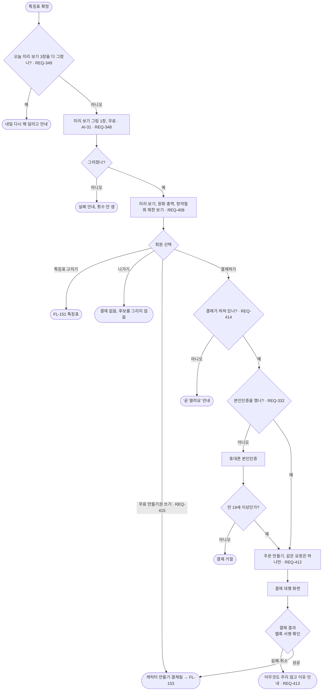

# FL-152 미리 보기를 보고 캐릭터 만들기 결제하기

Serves: REQ-348, REQ-349, REQ-332, REQ-408, REQ-412, REQ-413, REQ-414, REQ-415, REQ-350
Screens: SCR-143, SCR-144, SCR-162(본인인증 창과 결제 창은 결제 대행·본인확인 기관이 그림)
Context: CTX-022, CTX-024

- 충전권(FL-157), 아이템(FL-158), 구독(FL-164)도 '결제가 켜져 있나'부터 '결제 결과'까지 같은 순서예요.
