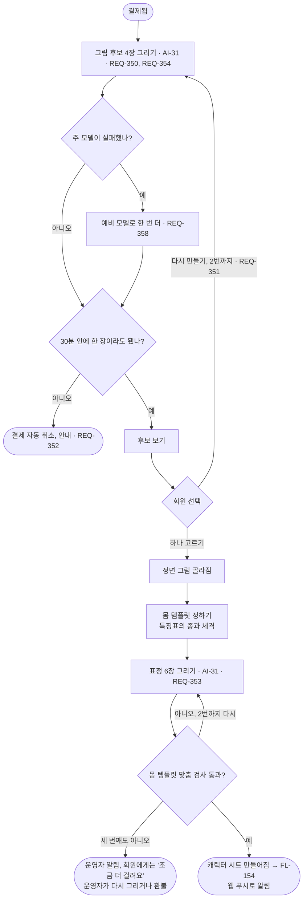

# FL-153 그림 후보를 골라 캐릭터 시트 만들기

Serves: REQ-350, REQ-351, REQ-352, REQ-353, REQ-354, REQ-358, REQ-424, REQ-425
Screens: 07 단계 뒤에 SCR를 채워요
Context: CTX-022

- 후보는 결제 확인부터 P95 120초(REQ-424), 캐릭터 시트는 P95 5분(REQ-425) 안에 보여야 해요. 회원은 기다리는 동안 앱을 닫아도 돼요.
