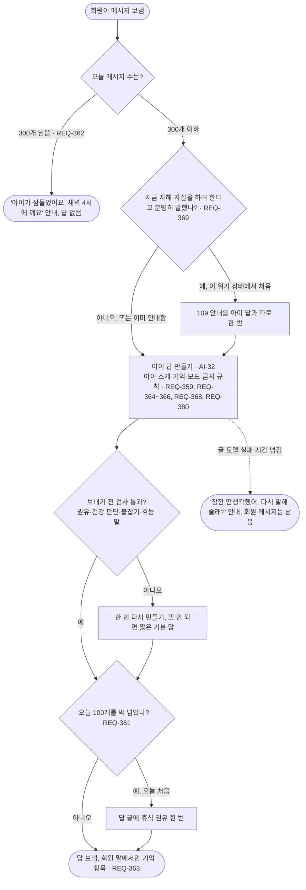

# FL-155 아이와 글로 이야기하기

Serves: REQ-359, REQ-360, REQ-361, REQ-362, REQ-363, REQ-364, REQ-365, REQ-366, REQ-368, REQ-369, REQ-380, REQ-426
Screens: 07 단계 뒤에 SCR를 채워요
Context: CTX-022(바뀌는 기존 맥락 CTX-008·011·012·013)

- 글 대화는 하루 한도를 쓰지 않아요(REQ-360). 메시지 수는 남용 막기와 휴식 권유에만 써요.
- 답을 만드는 동안 같은 회원의 메시지가 더 오면 기다렸다가 합쳐서 한 번 답해요(04 단계 SPEC-327).
