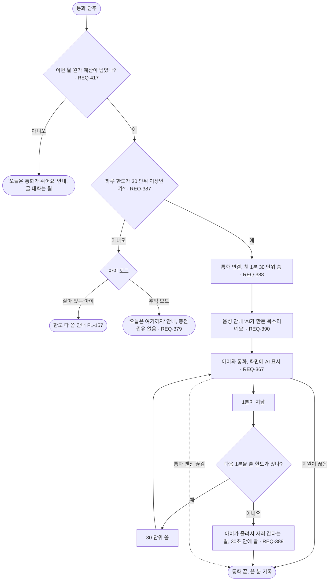

# FL-156 아이와 통화하기

Serves: REQ-387, REQ-388, REQ-389, REQ-390, REQ-367, REQ-379, REQ-417
Screens: SCR-147, SCR-148
Context: CTX-002, CTX-024

- 아이마다 다른 목소리(REQ-391)는 통화 엔진 측정 결론 뒤예요. 1차는 종(개·고양이)마다 정한 목소리 하나씩이에요.
