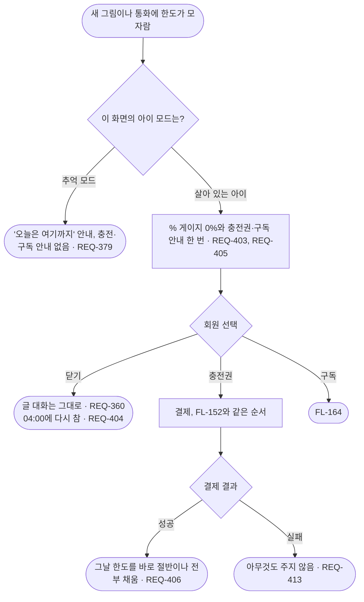

# FL-157 하루 한도를 다 쓰고 충전하기

Serves: REQ-403, REQ-404, REQ-405, REQ-406, REQ-379, REQ-360, REQ-413
Screens: 07 단계 뒤에 SCR를 채워요
Context: CTX-024

- 한도는 회원 단위예요. 함께 사는 아이와 추억 모드의 아이가 같은 한도를 써도, 충전 안내는 함께 사는 아이의 화면에서만 나와요.
