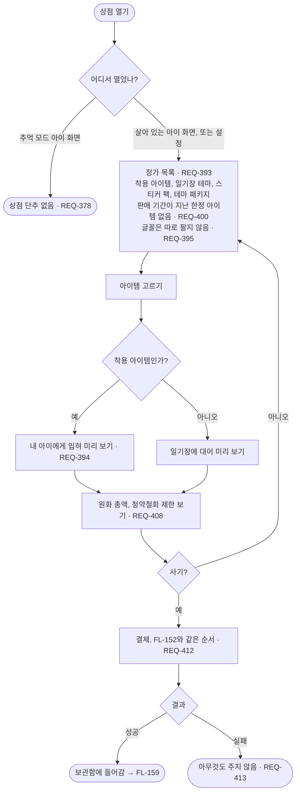

# FL-158 상점에서 미리 입혀 보고 사기

Serves: REQ-393, REQ-394, REQ-395, REQ-399, REQ-400, REQ-408, REQ-412, REQ-413, REQ-378
Screens: SCR-157, SCR-158, SCR-162
Context: CTX-023, CTX-024

- 모든 몸 템플릿의 레이어가 있는 착용 아이템만 목록에 나와요(REQ-399, 운영 도구가 올릴 때 막음).
