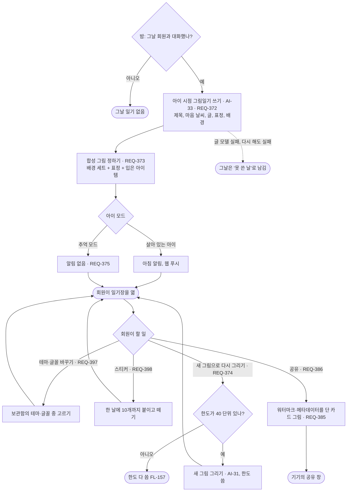

# FL-160 아이 시점 그림일기를 받고 일기장 꾸미기

Serves: REQ-372, REQ-373, REQ-374, REQ-375, REQ-385, REQ-386, REQ-397, REQ-398
Screens: 07 단계 뒤에 SCR를 채워요
Context: CTX-007, CTX-023

- 일기 하루의 경계와 다시 하기 간격은 지금 마롱이의 일기(SPEC-151\~153)를 그대로 따라요.
