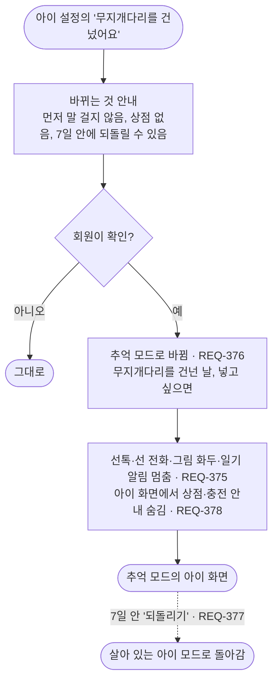

# FL-161 추억 모드로 바꾸기

Serves: REQ-376, REQ-377, REQ-375, REQ-378
Screens: 07 단계 뒤에 SCR를 채워요
Context: CTX-022

- 서비스는 대화에서 아이가 떠났다고 짐작해 모드를 바꾸지 않아요(REQ-376). 회원이 대화에서 그런 말을 해도 아이는 다정하게 받고, 바꾸는 단추가 어디 있는지만 알려요(04 단계 3.9).
