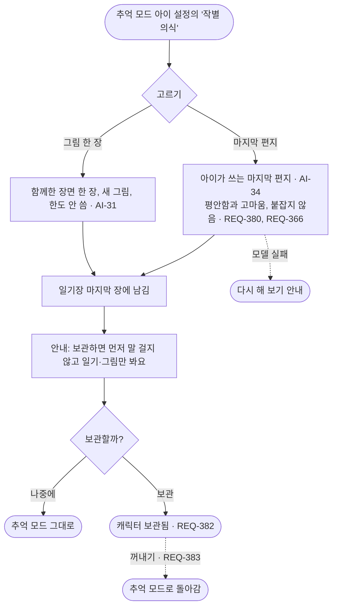

# FL-162 작별 의식을 하고 캐릭터 보관하기

Serves: REQ-381, REQ-382, REQ-383, REQ-380, REQ-366
Screens: SCR-149, SCR-150, SCR-153, SCR-154
Context: CTX-022

- 작별 의식은 아이마다 한 번이에요. 보관한 아이를 꺼낸 뒤에는 다시 할 수 없어요(새 제안: 의식의 무게를 지킴).
