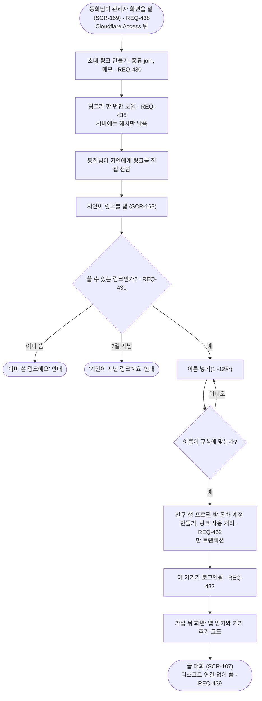

# FL-169 초대 링크로 가입하기

Serves: REQ-430, REQ-431, REQ-432, REQ-435, REQ-438, REQ-439
Screens: SCR-169, SCR-163, SCR-107
Context: CTX-026

- 초대 링크는 한 사람용이고 한 번 쓰면 끝나요. 이미 썼거나 7일이 지난 링크로는 아무것도 만들지 않아요(REQ-431).
- 가입 화면에 고지나 동의 단계는 없어요(D99, D103).
- 안드로이드에서는 브라우저로 가입한 뒤 그 화면에서 앱을 받고, 앱 첫 화면에 기기 추가 코드를 넣어요(FL-171). 앱이 링크를 직접 받는 기능은 만들지 않아요.
- 새 사람의 마롱이 이름은 '마롱이'이고 캐릭터는 기본 마롱이예요. 바꾸는 것은 FL-172\~174예요.
