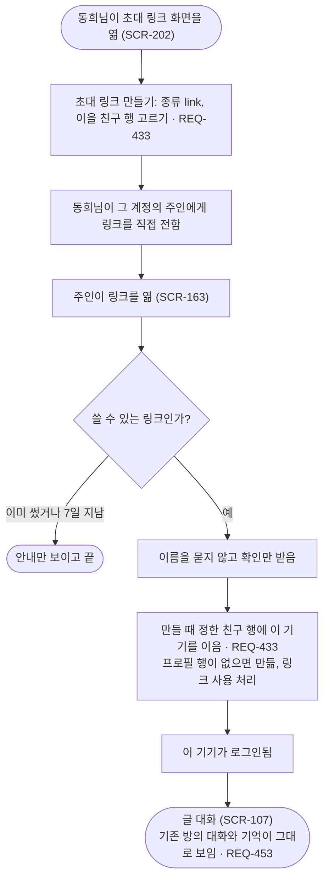

# FL-170 기존 계정 연결하기(link)

Serves: REQ-433, REQ-453
Screens: SCR-202, SCR-163, SCR-107
Context: CTX-026

- 지금 계정이 있는 사람(동희님, 현경님)이 쓰는 흐름이에요. 어느 친구 행에 잇는지는 링크를 만들 때 동희님이 정해요.
- 이메일이 같다는 이유로 계정을 자동으로 잇지 않아요(REQ-433).
- 대화·요약·메모·통화 기억은 복사하지 않아요. 기존 방에 방 주인만 채워져 있어서 그대로 이어 써요(REQ-453).
- 링크가 한 번만 쓰이고 7일 뒤에 못 쓰는 규칙은 FL-169와 같아요.
- 화면 번호 바뀜(D136 1-9, 2026-11-23): `link` 링크는 관리 페이지의 초대 링크 화면(SCR-202)에서 만들어요. 전에는 관리자 화면(SCR-169)이었어요.
