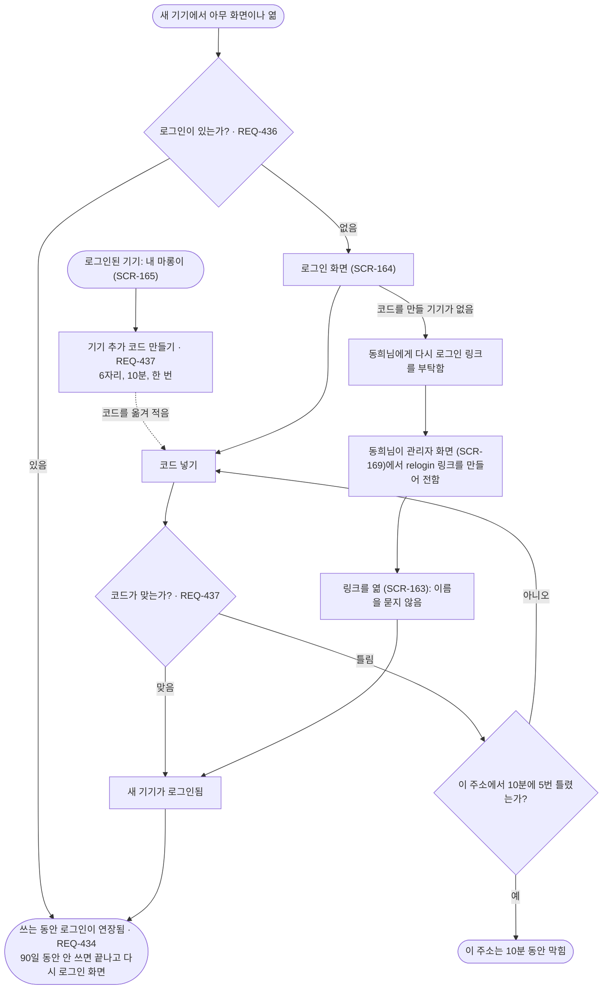

# FL-171 기기 추가하기와 다시 로그인하기

Serves: REQ-434, REQ-436, REQ-437
Screens: SCR-165, SCR-164, SCR-169, SCR-163
Context: CTX-026

- 앱 서버와 통화 서버가 같은 로그인을 인정해서, 한 번 로그인하면 글 대화와 통화를 모두 써요(REQ-436).
- 기기 추가 코드는 만든 지 10분이 지나거나 한 번 쓰면 못 써요. 다시 만들면 돼요.
- `relogin` 링크는 만들 때 정한 친구 행에만 이어지고, 한 번만 쓰이고 7일 뒤에 못 쓰는 규칙은 FL-169와 같아요.
- 내 마롱이 화면에서 로그아웃하면 그 기기의 로그인만 끝나요. 동희님이 관리자 화면에서 로그인을 끊으면 그 사람의 모든 기기가 끝나요.
