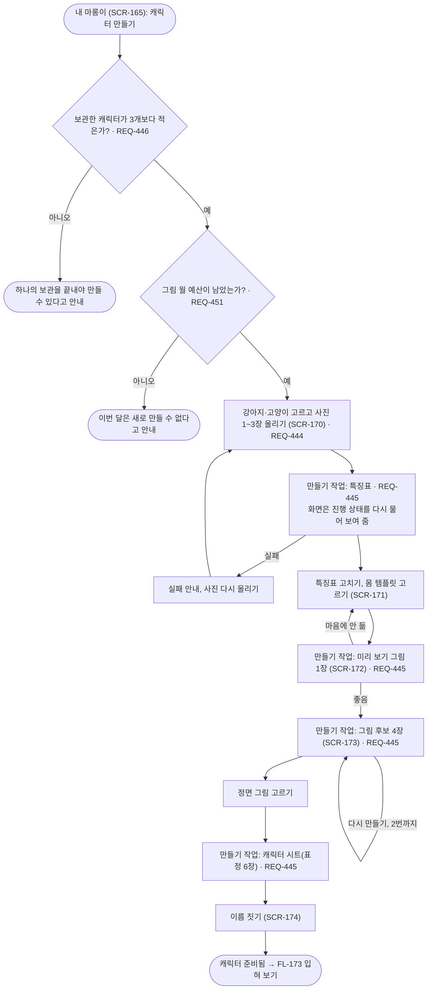

# FL-172 캐릭터 만들기

Serves: REQ-444, REQ-445, REQ-446, REQ-451
Screens: SCR-165, SCR-170, SCR-171, SCR-172, SCR-173, SCR-174
Context: CTX-027

- 순서와 사진 규칙은 반려동물 명세 SPEC-316\~325 그대로예요(사진은 화면에서 줄이고 EXIF를 지움, 사람 얼굴 가림, 원본 저장 안 함, 그림 모델에는 사진을 보내지 않음). 결제 단계는 없어서 미리 보기 뒤에 바로 그림 후보로 가요(REQ-444).
- 만들기 작업이 도는 동안 화면을 나가도 돼요. 다시 열면 멈춘 단계에서 이어지고, 앱은 끝나면 알림을 받아요(REQ-445).
- 그림 월 예산의 80%에 닿으면 동희님에게 알리고, 100%에 닿으면 새 만들기를 거절해요. 이미 만든 캐릭터는 그대로 쓸 수 있어요(REQ-451).
- 살아 있는 아이만 만들어요. 추억 모드는 없어요.
