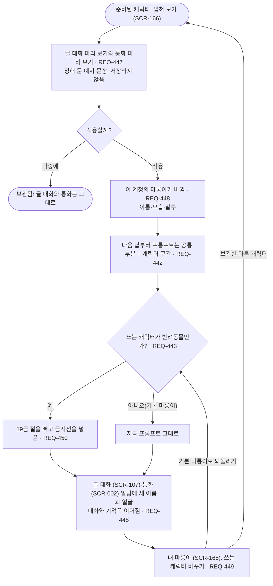

# FL-173 입혀 보고 적용하고 되돌리기

Serves: REQ-442, REQ-443, REQ-447, REQ-448, REQ-449, REQ-450
Screens: SCR-166, SCR-165, SCR-107, SCR-002
Context: CTX-027

- 적용하기 전에는 글 대화·통화·알림에 아무 영향이 없어요. 입혀 보기는 모델을 부르지 않아요(REQ-447).
- 금지선은 셋이에요: 건강을 판단하지 않고, 붙잡는 말을 하지 않고, 진짜 그 아이라고 주장하지 않아요(REQ-450).
- 통화 화면의 얼굴은 캐릭터의 표정 6장을 써요. 기본 마롱이는 지금 그림 그대로예요.
- 반려동물 캐릭터를 쓰는 동안에는 그림 화두를 받지 않고 글 화두만 받아요(그림 화두가 기본 마롱이 그림이기 때문이에요).
- 캐릭터의 보관을 끝낼 수 있어요. 쓰던 캐릭터면 기본 마롱이로 돌아가요.
