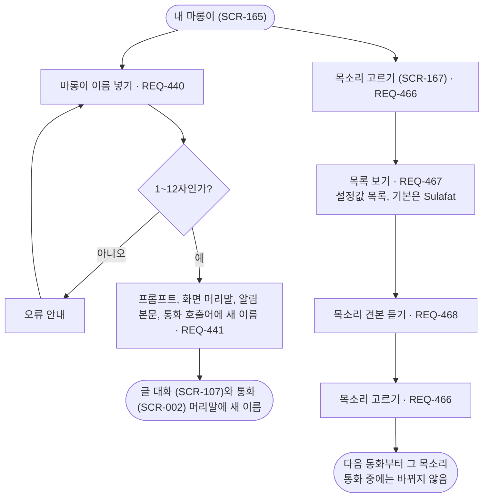

# FL-174 이름과 목소리 바꾸기

Serves: REQ-440, REQ-441, REQ-466, REQ-467, REQ-468
Screens: SCR-165, SCR-167, SCR-107, SCR-002
Context: CTX-027

- 알림 채널 이름('마롱이 톡', '마롱이 전화')과 앱 이름은 바뀌지 않아요(REQ-441의 범위 밖).
- 목소리 목록이 정해지기 전에는 Sulafat 하나만 보여요. 견본이 없는 목소리는 '견본 없음'으로 보이고 고를 수는 있어요.
- 설정값 목록에서 빠진 목소리를 골라 둔 사람은 다음 통화부터 기본 목소리로 통화해요.
- 이름과 목소리를 바꿔도 대화와 기억은 그대로예요.
