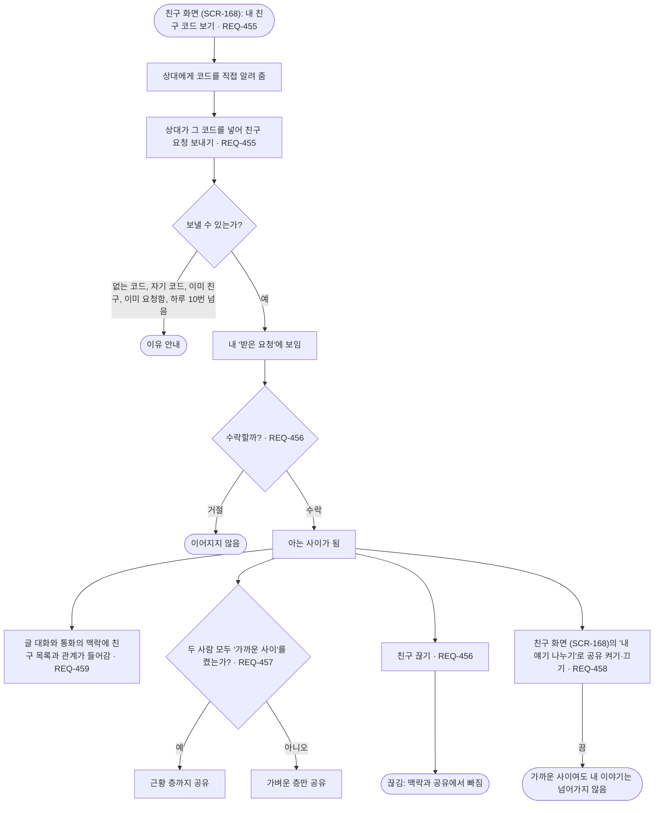

# FL-175 친구 요청하고 수락하고 끊기

Serves: REQ-455, REQ-456, REQ-457, REQ-458, REQ-459
Screens: SCR-168, SCR-165
Context: CTX-028

- 회원 목록은 보여 주지 않아요. 친구 코드를 아는 사람만 요청을 보낼 수 있어요.
- 공유 자체를 켜고 끄는 설정('내 얘기 나누기')은 친구 화면(SCR-168)에서 본인이 바꿔요(REQ-458). 꺼 두면 가까운 사이여도 내 이야기는 넘어가지 않아요.
- 공유 층의 내용 규칙은 지금 그대로예요: 통화 내용은 공유하지 않고, 위기·몸·식단 얘기는 넘어가지 않아요.
- 마롱이끼리 직접 말을 주고받는 것은 이번에 만들지 않아요.
