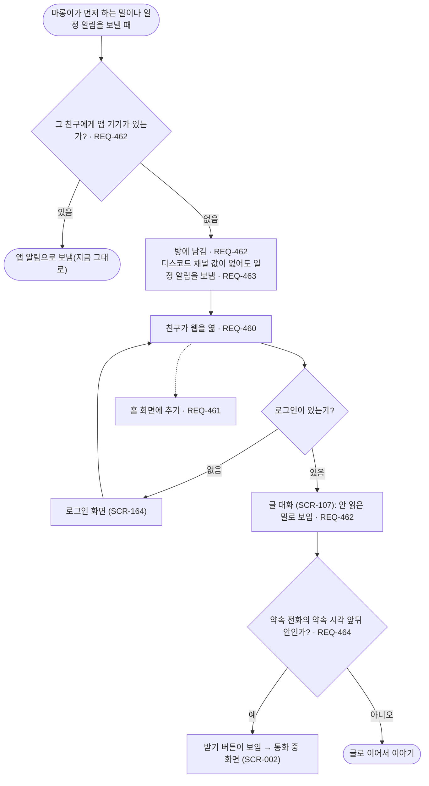

# FL-176 웹에서 밀린 연락 받기

Serves: REQ-460, REQ-461, REQ-462, REQ-463, REQ-464
Screens: SCR-164, SCR-107, SCR-001
Context: CTX-001

- 웹에서는 가입·로그인, 글 대화, 통화, 설정, 친구 맺기를 앱과 같은 페이지로 써요(REQ-460).
- 웹에는 푸시 알림과 전화 벨이 없어요. 그래서 먼저 하는 말은 웹을 열었을 때 보여요(11/18 인계: 웹 알림은 필요 없음).
- 약속 전화의 받기 버튼이 보이는 시간 범위와 자리는 04 명세와 08 화면 정의에서 정해요.
- 홈 화면 추가는 설정 파일과 아이콘만 더해요. 서비스 워커와 웹 푸시는 넣지 않아요(REQ-461).
