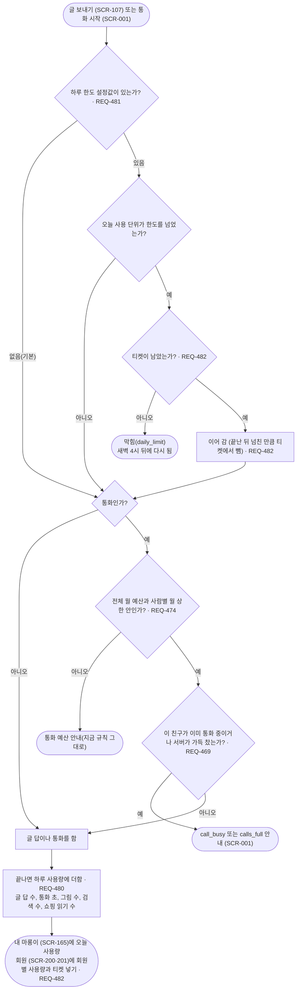

# FL-177 하루 사용량 세기와 한도

Serves: REQ-469, REQ-474, REQ-480, REQ-481, REQ-482
Screens: SCR-107, SCR-001, SCR-165, SCR-200, SCR-201
Context: CTX-029

- 하루 한도 설정값은 기본이 비어 있어요. 그동안은 세기만 하고 아무도 막지 않아요(REQ-481, D102).
- 하루는 새벽 4시(한국 시각)에 바뀌어요.
- 티켓은 동희님이 관리자 화면에서만 넣어요. 판매와 결제는 없어요(REQ-482).
- 통화는 한 친구에 하나, 서버 전체는 설정값(기본 3)까지 동시에 열려요(REQ-469). 전체 월 150달러와 80·100·120% 규칙은 지금 그대로이고, 사람별 월 상한은 설정값이 있을 때만 봐요(REQ-474).
- 캐릭터 만들기의 그림 수도 하루 사용량에 더해져요. 그림 월 예산은 FL-172에서 따로 봐요.
- 화면 번호 바뀜(D136 1-9, 2026-11-23): 회원별 사용량은 관리 페이지의 회원 화면(SCR-200), 티켓 넣기는 회원 한 사람 화면(SCR-201)에 있어요. 전에는 관리자 화면(SCR-169)이었어요.
