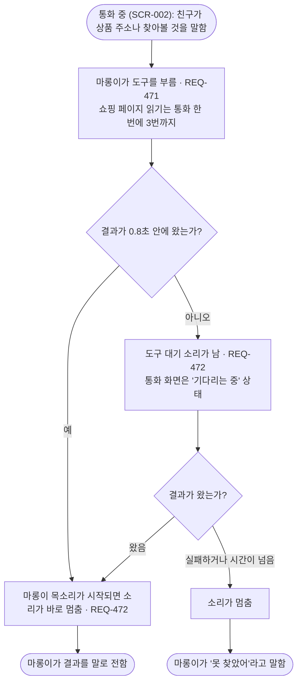

# FL-178 통화 중 도구를 기다리기

Serves: REQ-471, REQ-472
Screens: SCR-002
Context: CTX-002

- 도구 대기 소리는 도구가 돌 때와 모델이 생각하느라 답이 늦을 때 모두 나요. 마롱이 목소리와 겹치지 않아요(REQ-472).
- "기다려" 같은 말은 넣지 않아요(11/18 인계, 1안).
- 쇼핑 페이지 읽기의 하루 한도는 글 대화와 함께 세요(REQ-471).
- 소리를 내기 시작하는 시간(0.8초)과 도구의 시간 제한은 04 명세(SPEC-388, SPEC-389)의 값이에요.
- 도구 호출을 기다리지 않는 방식(2안)은 이번에 넣지 않아요.
