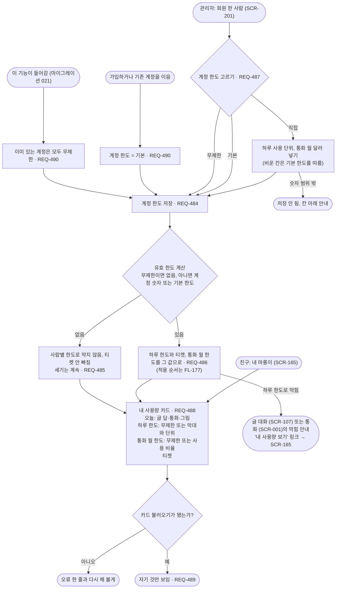

# FL-179 계정 한도 정하기와 내 사용량 보기

Serves: REQ-484, REQ-485, REQ-486, REQ-487, REQ-488, REQ-489, REQ-490
Screens: SCR-201, SCR-165, SCR-107, SCR-001
Context: CTX-029, CTX-006

- 계정 한도는 관리자만 바꿔요. 친구 화면에는 바꾸는 버튼이 없어요(REQ-487).
- 바꾼 값은 그 친구의 다음 글 보내기·통화 시작부터 적용돼요. 진행 중인 통화는 끊지 않아요.
- 무제한 계정도 서버 전체 장치(통화 전체 월 150달러, 그림 월 예산, 전체 합계 한도, 동시 통화 수)는 지금처럼 따라요. 이 막힘은 FL-177과 FL-009·172의 안내를 그대로 써요.
- 통화 월 한도는 통화 비용 표의 기준인 UTC 달이라 한국 시각으로 매달 1일 09:00에 다시 채워져요. 하루 한도는 새벽 4시(한국 시각)예요.
- 친구 화면에는 통화 비용을 달러로 보이지 않고 비율만 보여요. 관리자 화면에는 이번 달 통화 비용(달러)이 있어요.
- 시작 칸 바뀜(D136 1-8, 2026-11-23): 전에는 "관리자: 관리자 화면 회원 목록 (SCR-169)"이었어요. 관리 페이지가 나뉘어 한도 바꾸기는 회원 한 사람 화면(SCR-201)에서 해요. 그 뒤 칸은 그대로예요.
