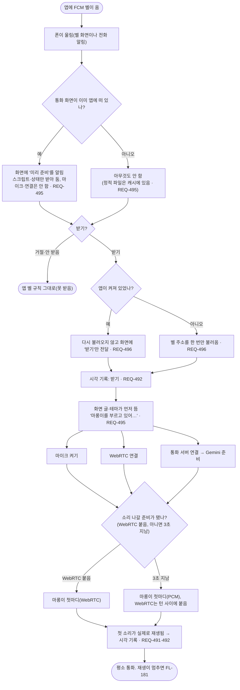

# FL-180 벨 받기에서 마롱이 첫 목소리까지

Serves: REQ-491, REQ-492, REQ-495, REQ-496, REQ-497
Screens: 벨 화면 SCR-110·전화 알림 SCR-111([app-ring.md](../app-ring.md)), 통화 중 SCR-002(앱에서는 통화 창 SCR-101 안)
Context: CTX-002
Bug: BUG-108([12 QA](../12-qa/call-connect.md))

- 서버 기록: 새 통화의 첫 구간은 '시작', 모델 준비 시각은 Gemini가 준비를 알린 때예요(REQ-497).
- 앱 화면 쪽(가운데 세 분기와 첫마디 붙잡기)은 서버가 내려주는 통화 페이지라 앱 업데이트 없이 바뀌어요. 받기·미리 준비 분기(위쪽)는 앱 0.3.1이에요.
