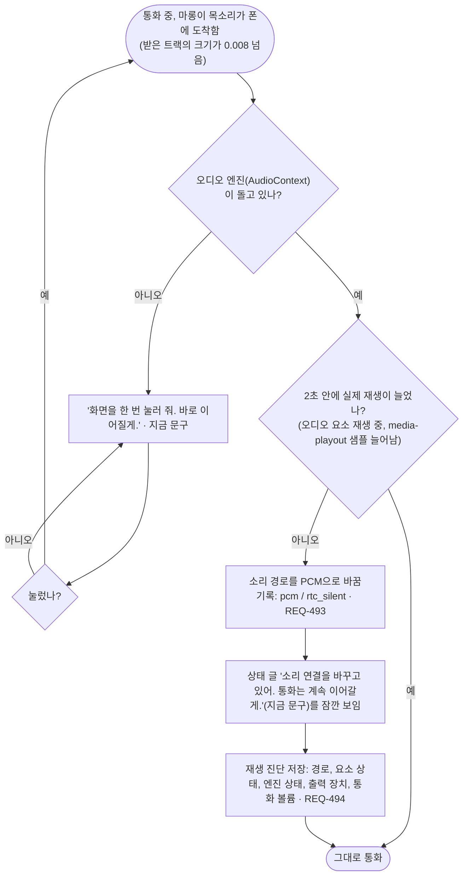

# FL-181 마롱이 목소리가 안 들릴 때

Serves: REQ-493, REQ-494
Screens: 통화 중 SCR-002(앱에서는 통화 창 SCR-101 안), 상태는 [08-screens/call-connect.md](../08-screens/call-connect.md)
Context: CTX-002
Bug: BUG-109([12 QA](../12-qa/call-connect.md))

- 출력 장치(앱 0.3.1): 유선 → USB → 블루투스 → 스피커 순으로 고르고, 수화부는 고르지 않아요(REQ-494). 고른 장치는 재생 진단에 들어가요.
- PCM으로 바꾼 뒤에도 친구가 안 들린다고 하면, 재생 진단(출력 장치·통화 볼륨)으로 원인을 봐요. 이 흐름이 저절로 더 하는 일은 없어요.
