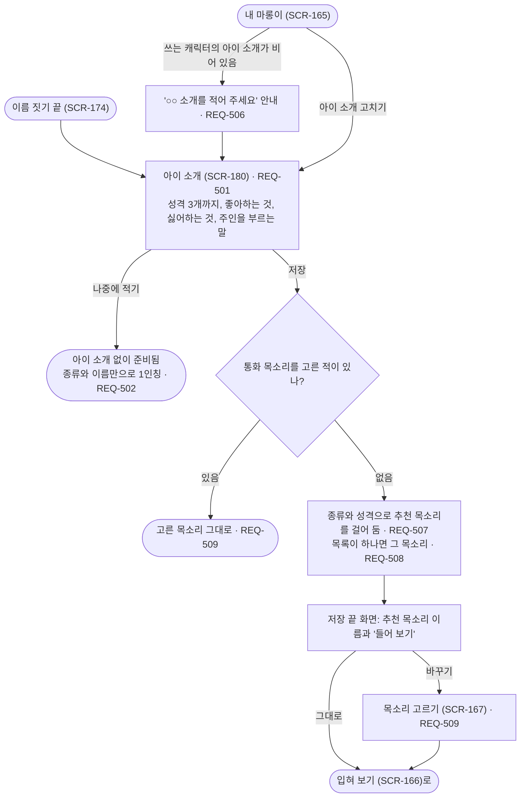

# FL-185 아이 소개 적기와 추천 목소리

Serves: REQ-501, REQ-502, REQ-506, REQ-507, REQ-508, REQ-509
Screens: SCR-174, SCR-180, SCR-165, SCR-167
Context: CTX-027

- 아이 소개는 반려동물 캐릭터에만 있어요. 기본 마롱이에는 없어요.
- 아이 소개를 고쳐도 친구가 직접 고른 목소리는 바뀌지 않아요(REQ-509). 추천 목소리는 처음 한 번만 걸려요.
- 이미 만든 캐릭터는 아이 소개가 비어 있어서, 내 마롱이 화면에 안내가 보여요(REQ-506).
