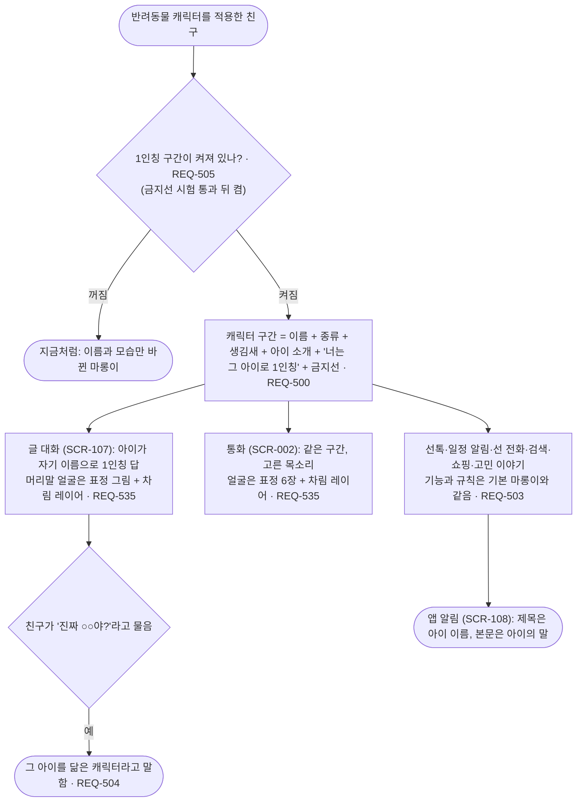

# FL-186 아이와 1인칭으로 이야기하기

Serves: REQ-500, REQ-503, REQ-504, REQ-505, REQ-535
Screens: SCR-107, SCR-002, SCR-108
Context: CTX-027, CTX-001, CTX-002

- 바뀌는 것은 말하는 이뿐이에요. 무엇을 언제 보내는지, 하루 상한, 조용 시간, 도구 상한은 기본 마롱이와 같아요(D116).
- 금지선 셋(건강 판단, 붙잡는 말, 진짜 그 아이라는 주장)은 1인칭이 켜져도 그대로예요(REQ-504).
- 기억과 지난 대화는 그대로 이어져요. 캐릭터를 적용하기 전의 대화도 아이가 기억해요(통합 앱 규칙, D91).
