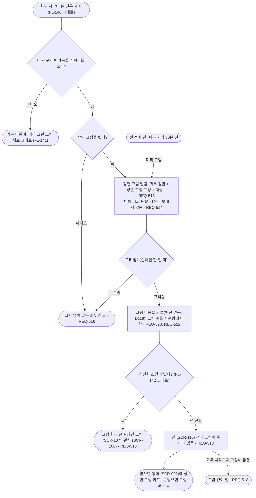

# FL-187 아이 그림 화두와 선 전화

Serves: REQ-510, REQ-512, REQ-513, REQ-514, REQ-516, REQ-518, REQ-520, REQ-522
Screens: SCR-107, SCR-108, SCR-110, SCR-002
Context: CTX-020, CTX-031, CTX-009

- 화두 장면 목록, 하루 하나·7일 세 번·30일 되풀이 금지, 선 전화 시간대는 기본 마롱이와 같아요(REQ-503).
- 장면 그림은 매번 새로 그려요. 지난번 그림을 다른 날 화두에 쓰지 않아요(REQ-512).
- 그림 화두 글은 아이가 1인칭으로 그 장면을 자기 일상처럼 나누고 되묻는 질문으로 끝나요.
