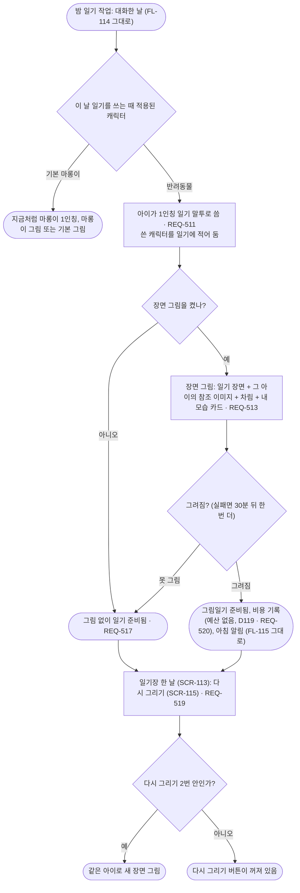

# FL-188 아이가 쓰는 그림일기

Serves: REQ-511, REQ-512, REQ-513, REQ-517, REQ-519, REQ-520
Screens: SCR-113, SCR-115
Context: CTX-007, CTX-031

- 그림 없는 일기에는 기본 그림(마롱이 그림)을 붙이지 않고, 그림 자리에 '오늘은 그림을 못 그렸어요'를 보여요(REQ-517).
- 일기를 쓴 뒤 캐릭터를 바꿔도 그 날 일기를 쓴 아이는 그대로예요. 다시 그리기도 그 아이로 그려요.
- 그림 없는 일기도 다시 그리기로 그림을 받을 수 있어요(일기 하나에 2번). 그림 월 예산은 두지 않아요(D119).
