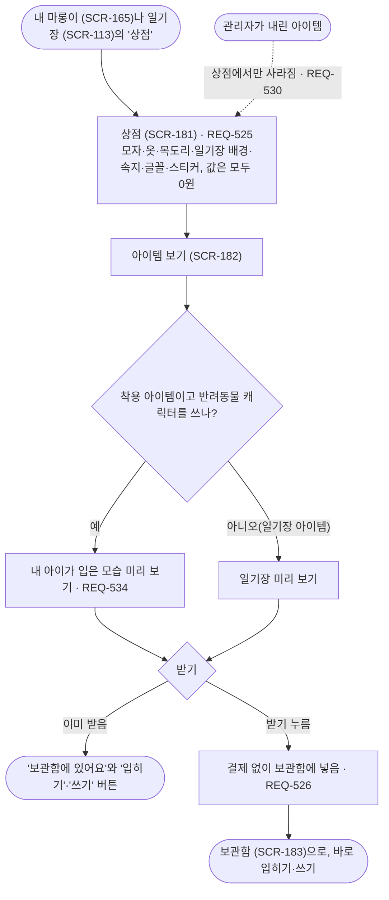

# FL-189 0원 상점에서 아이템 받기

Serves: REQ-525, REQ-526, REQ-527, REQ-530, REQ-532, REQ-534
Screens: SCR-181, SCR-182, SCR-183
Context: CTX-030

- 상점 화면에는 값이 보여요(지금은 모두 '0원'). 결제 화면이나 충전권 안내는 없어요(REQ-527, D103).
- 뽑기 같은 확률형 상품은 없어요(REQ-531).
- 받은 아이템은 그 친구의 모든 캐릭터가 같이 써요.
