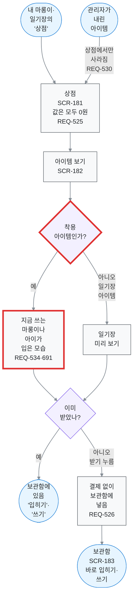

# FL-189 0원 상점에서 아이템 받기

Serves: REQ-525, REQ-526, REQ-527, REQ-530, REQ-532, REQ-534, REQ-691
Screens: SCR-181, SCR-182, SCR-183
Context: CTX-030

| Shape | Means |
| --- | --- |
| Rectangle | 화면이나 친구가 하는 한 단계 |
| Diamond | 분기. 나가는 선마다 이름이 있어요 |
| Stadium | 흐름이 시작하거나 끝나는 곳 |
| K에서 오는 선 | 다른 흐름(FL-192)에서 오는 일 |
| 빨간 굵은 테 | 기능 변경 1이 바꾸는 곳: 착용 아이템이면 기본 마롱이도 미리 봐요 |

- 상점 화면에는 값이 보여요(지금은 모두 '0원'). 결제 화면이나 충전권 안내는 없어요(REQ-527, D103).
- 뽑기 같은 확률형 상품은 없어요(REQ-531).
- 받은 아이템은 그 친구의 모든 캐릭터가 같이 써요.
- 기능 변경 1(2026-11-28, D192. 체크포인트 통과 D193): 갈림과 미리 보기 칸을 기본 마롱이까지 넓혔어요. 바뀌기 전 글은 [02 기능 변경 목록 1](../02-prd/pet-app.md#기본-마롱이-입히기-기능-변경-목록-1)의 1-7에 있어요. `MARONG_DEFAULT_WEAR=0`이면 기본 마롱이는 지금처럼 썸네일만 봐요.
- 그림 손봄(2026-11-28, 뜻은 그대로): 칸 글을 줄이고 칸 종류와 줄바꿈을 그림 문법에 맞췄어요(main에서 diagram-check 22건 → 0건). 줄이기 전 글: 시작 '내 마롱이 (SCR-165)나 일기장 (SCR-113)의 '상점'', 상점 '모자·옷·목도리·일기장 배경·속지·글꼴·스티커, 값은 모두 0원', 이미 받음의 끝 ''보관함에 있어요'와 '입히기'·'쓰기' 버튼', 받기의 끝 '보관함 (SCR-183)으로, 바로 입히기·쓰기'.
