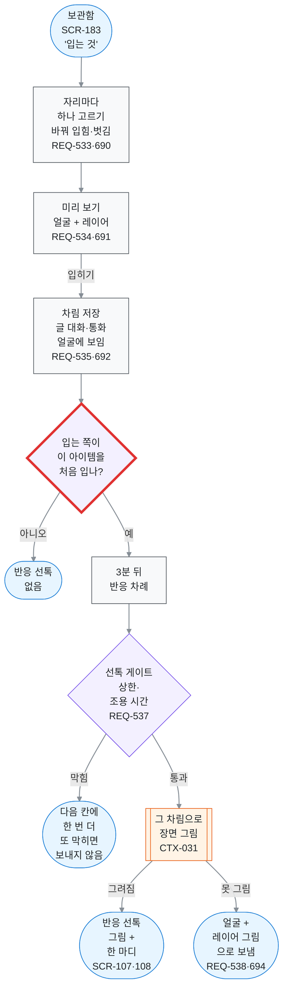

# FL-190 마롱이나 아이에게 입히고 아이템 반응 선톡 받기

Serves: REQ-533, REQ-534, REQ-535, REQ-536, REQ-537, REQ-538, REQ-690, REQ-691, REQ-692, REQ-693, REQ-694
Screens: SCR-183, SCR-107, SCR-108, SCR-002, SCR-001, SCR-165
Context: CTX-030, CTX-009, CTX-031

| Shape | Means |
| --- | --- |
| Rectangle | 화면이나 서버가 하는 한 단계 |
| Diamond | 분기. 나가는 선마다 이름이 있어요 |
| Stadium | 흐름이 시작하거나 끝나는 곳 |
| 두 줄 테 주황 칸 | 그림 모델을 부르는 단계 |
| 빨간 굵은 테 | 기능 변경 1이 바꾸는 곳: 입는 쪽은 기본 마롱이(친구마다 하나)나 이 캐릭터예요 |

- 반응 선톡은 선톡 한 번으로 세어요. 하루 상한을 넘기지 않아요(REQ-537).
- 처음 상점에서 받은 아이템도 처음 입으면 반응 선톡이 있어요. 여러 개를 한꺼번에 입히면 마지막에 입힌 것 하나로만 보내요[새 제안].
- 기본 마롱이도 입어요(D192, 2026-11-28 기능 변경 1, 제안·체크포인트 전). 기본 마롱이의 반응 선톡 그림은 도메인 9.7 질문 2의 답을 따라요. 바뀌기 전 글은 [02 기능 변경 목록 1](../02-prd/pet-app.md#기본-마롱이-입히기-기능-변경-목록-1)의 1-8에 있어요.
- 기본 마롱이의 그림 화두는 미리 그린 그림 그대로라 차림이 보이지 않아요(REQ-695, 질문 3).
- 그림 손봄(2026-11-28, 뜻은 그대로): 칸 글을 줄이고 칸 종류와 줄바꿈을 그림 문법에 맞췄어요(main에서 diagram-check 26건 → 0건). 줄이기 전 글: 고르기 '착용 아이템 고르기: 자리(머리·몸·목)마다 하나, 같은 자리는 바꿔 입힘, 벗기기', 미리 보기 '표정 그림 + 아이템 레이어', 저장 '차림 저장. 글 대화·통화 얼굴에 바로 보임', 막힘의 끝 '다음 선톡 칸의 첫 차례에 한 번 더, 그래도 막히면 보내지 않음', 그려짐의 끝 '아이템 반응 선톡: 장면 그림 + 아이의 한 마디 (SCR-107, 알림 SCR-108)', 못 그림의 끝 '표정 그림 + 아이템 레이어로 보냄'.
