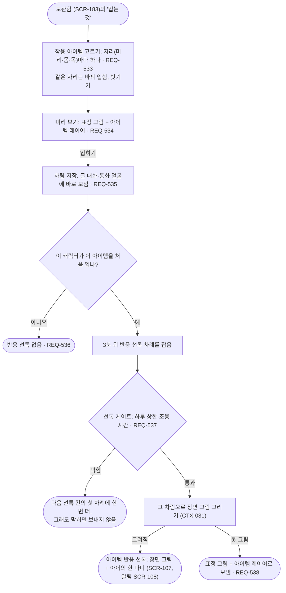

# FL-190 아이에게 입히고 아이템 반응 선톡 받기

Serves: REQ-533, REQ-534, REQ-535, REQ-536, REQ-537, REQ-538
Screens: SCR-183, SCR-107, SCR-108, SCR-002
Context: CTX-030, CTX-009, CTX-031

- 반응 선톡은 선톡 한 번으로 세어요. 하루 상한을 넘기지 않아요(REQ-537).
- 처음 상점에서 받은 아이템도 처음 입으면 반응 선톡이 있어요. 여러 개를 한꺼번에 입히면 마지막에 입힌 것 하나로만 보내요[새 제안].
- 기본 마롱이가 입는지는 질문 A의 답을 기다려요(추천: 반려동물 캐릭터만).
