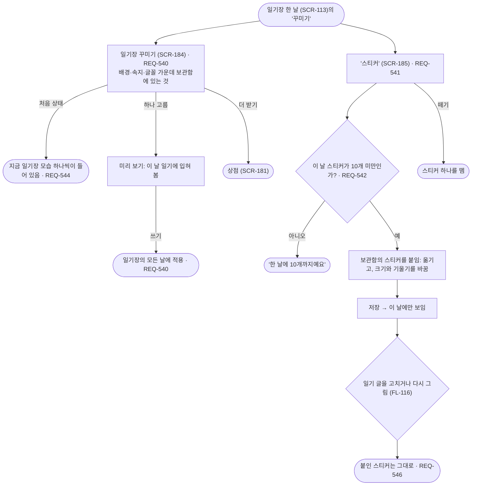

# FL-191 일기장 꾸미기와 스티커

Serves: REQ-540, REQ-541, REQ-542, REQ-543, REQ-544, REQ-545, REQ-546
Screens: SCR-113, SCR-184, SCR-185, SCR-181
Context: CTX-030, CTX-007

- 기본 마롱이를 쓰는 친구도 같은 화면과 규칙이에요(REQ-543).
- 글꼴은 무료로 쓸 수 있는 라이선스의 글꼴만 있고, 앱 서버가 글꼴 파일을 내려 줘요(REQ-545).
- 원고지 칸 모양은 속지의 한 종류예요. 처음 일기장은 지금 원고지 칸 그대로예요(REQ-544).
