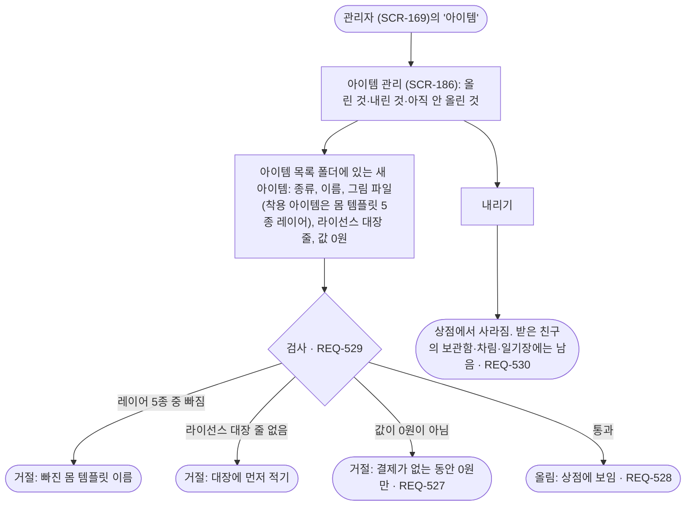

# FL-192 관리자가 아이템을 올리고 내리기

Serves: REQ-527, REQ-528, REQ-529, REQ-531, REQ-532
Screens: SCR-169, SCR-186
Context: CTX-030

- 처음 아이템 45개(모자 4, 옷 4, 목도리 2, 일기장 배경 6, 속지 4, 글꼴 5, 스티커 20)는 이 화면 대신 마이그레이션과 함께 넣는 아이템 목록 파일로 올려요(REQ-532).
- 아이템 그림은 서버 밖에서 그려 검수한 뒤 저장소의 아이템 목록 폴더에 넣어요(검수와 라이선스 기록이 Git에 남게). 이 화면은 그림을 그리거나 파일을 받지 않고, 폴더에 있는 아이템을 상점에 올리고 내리기만 해요.
