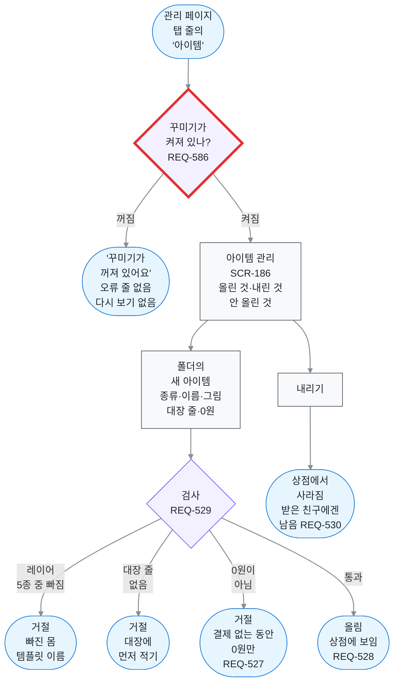

# FL-192 관리자가 아이템을 올리고 내리기

Serves: REQ-527, REQ-528, REQ-529, REQ-531, REQ-532, REQ-586(관리 페이지 기능 변경 3, 제안)
Screens: SCR-186
Context: CTX-030

| Shape | Means |
| --- | --- |
| Rectangle | 화면이나 관리자가 하는 한 단계 |
| Diamond | 분기. 나가는 선마다 이름이 있어요 |
| Stadium | 흐름이 끝나는 곳 |
| 빨간 굵은 테 | 기능 변경 3이 더하는 분기: 꾸미기가 꺼져 있으면 안내에서 끝나요 |

꾸미기가 꺼진 서버에서는 아이템 화면이 안내 한 줄에서 끝나고, 켜진 서버에서는 지금처럼 올리기·내리기로 간다는 것을 보세요. 칸의 글은 그림 문법(한 줄 120px 안쪽)에 맞춰 줄였고, 줄이기 전 글은 아래 '그림 손봄' 메모에 그대로 있어요.

- 처음 아이템 45개(모자 4, 옷 4, 목도리 2, 일기장 배경 6, 속지 4, 글꼴 5, 스티커 20)는 이 화면 대신 마이그레이션과 함께 넣는 아이템 목록 파일로 올려요(REQ-532).
- 아이템 그림은 서버 밖에서 그려 검수한 뒤 저장소의 아이템 목록 폴더에 넣어요(검수와 라이선스 기록이 Git에 남게). 이 화면은 그림을 그리거나 파일을 받지 않고, 폴더에 있는 아이템을 상점에 올리고 내리기만 해요.
- 꾸미기 꺼짐 분기(관리 페이지 기능 변경 3, D145, 2026-11-24 제안. [기능 변경 목록 3-3](../02-prd/admin.md#꾸미기-꺼짐-안내와-앱-지워진-폰-기능-변경-목록-3)): 꾸미기가 꺼진 서버에서는 아이템 API(API-263)가 404라서 흐름이 '꾸미기가 꺼져 있어요'에서 끝나요(SCR-186#decor-off, SPEC-459). 꾸미기를 켜는 일은 지금처럼 서버 설정이고 이 화면에 단추는 없어요. 켜진 서버의 흐름은 그대로예요.
- 그림 손봄(2026-11-24, 뜻은 그대로): 칸 글을 줄이고 칸 종류와 줄바꿈을 그림 문법에 맞췄어요. 줄인 글: 새 아이템의 조건은 '종류, 이름, 그림 파일(착용 아이템은 몸 템플릿 5종 레이어), 라이선스 대장 줄, 값 0원', 거절은 '빠진 몸 템플릿 이름', '대장에 먼저 적기', '결제가 없는 동안 0원만', 내리기의 끝은 '상점에서 사라짐. 받은 친구의 보관함·차림·일기장에는 남음'이에요.
- 들어가는 경로 바뀜(D136 1-10, 2026-11-23): '아이템'은 관리자 화면(SCR-169)의 한 줄이 아니라 모든 관리 화면 위 탭 줄의 한 칸이에요. SCR-186의 번호·경로(`/chat/admin/items`)·상태·API-263\~265는 그대로예요.
