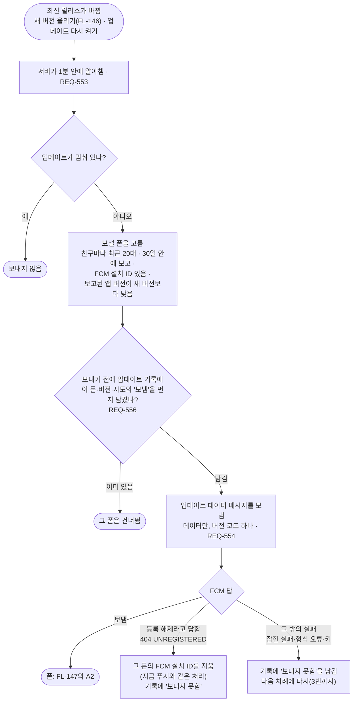

# FL-193 뒤처진 폰 깨우기(서버)

Serves: REQ-553, REQ-554, REQ-556, REQ-313
Screens: 없음(서버가 화면 없이 함)
Context: CTX-021

2026-11-22 기능 변경(D122·D124)으로 새로 생긴 흐름이에요. 새 릴리스가 최신이 되면 서버가 뒤처진 폰마다 업데이트 데이터 메시지를 한 번 보내요. 앱이 받아서 하는 일은 FL-147의 A2예요.

2026-11-24 FCM 등록 해제 판단 기능 변경(D180)으로 FCM 답의 두 선 이름을 바꿨어요(D182 F-5, 승인한 사람 사용자님). 칸과 선의 수는 그대로예요. 바뀌기 전 글은 [FCM 등록 해제 판단 도메인 7절](../01-domain/fcm-unregistered.md#7-바뀌는-승인-항목항목마다-따로-여쭤요)의 F-5에 있어요.

- 서버는 30초마다 릴리스를 보고, 바뀐 때와 봇이 시작할 때, 그 밖에는 10분마다 보낼 폰을 골라요(SPEC-430). '다음 차례'는 그 10분 차례예요. 보내지 못한 폰은 3번까지 다시 보내요. 보내기 전에 '보냄'을 기록에 먼저 남기고(폰·버전·시도마다 한 줄만 들어가는 유일 인덱스), 남기지 못하면 보내지 않아요. 그래서 봇이 다시 시작하거나 기록 쓰기가 실패해도 두 번 보내지 않아요. 보낸 뒤 '보내지 못함'을 적기 전에 봇이 멈추면 그 시도는 보낸 것으로 쳐요(많아야 한 번). 그 폰은 하루 한 번 확인에서 새 버전을 받아요.
- 폰은 친구마다 최근에 보고한 20대 안에서만 골라요(지금 푸시와 같은 상한). 한 차례에 100개까지, 동시에 4개까지 보내고, 남은 폰은 다음 30초 차례에 이어서 보내요. 가짜 폰 줄이 많아도 한 차례가 길어지지 않게 하려는 거예요(2026-11-23 보안 검토). 숫자는 추측이에요.
- 0.3.2 이하 앱도 이 메시지를 받으면 지금 코드대로 6시간 규칙 안에서 확인해요. 알림은 뜨지 않아요(TC-602).
- 친구에게 보이는 것은 없어요. 설치가 된 뒤에도 '설치됨' 알림은 없어요(REQ-324).
