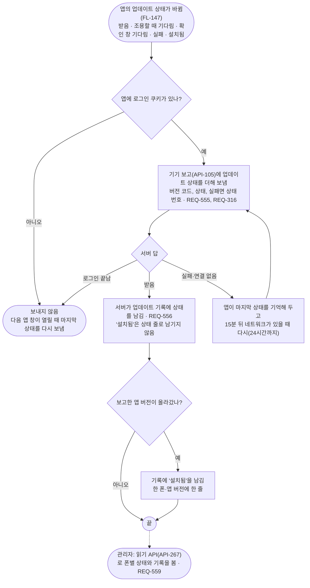

# FL-194 업데이트 상태 보고

Serves: REQ-555, REQ-316, REQ-556, REQ-559
Screens: 없음(앱이 화면 없이 함). 관리자가 보는 화면은 관리 페이지 다시 만들기가 정해요
Context: CTX-021

2026-11-22 기능 변경(D125·D126)으로 새로 생긴 흐름이에요. 앱은 업데이트 상태가 바뀔 때마다 앱 화면을 열지 않고 서버에 보고하고, 서버는 업데이트 기록에 쌓아요. 관리자는 읽기 API로 봐요.

- '설치됨'은 새 버전 앱이 처음 깨어날 때(안드로이드의 앱 교체 신호) 보내요. 앱 화면을 열지 않아도 돼요. 서버는 이 보고를 상태 줄로 남기지 않고, 보고한 앱 버전이 올라간 것으로 '설치됨' 한 줄만 남겨요. 웹 페이지의 기기 보고가 새 버전을 먼저 실어 와도 한 줄이에요.
- 앱이 마지막으로 보낸 버전·상태·실패 번호를 기억하고, 셋이 모두 같으면 다시 보내지 않아요. 같은 버전의 실패라도 번호가 다르면 보내요.
- 서버 로그에는 지금처럼 버전과 결과만 남아요(REQ-312). 기록에는 설치 ID(앱이 처음 만든 기기 번호, TBL-101의 `install_id`)를 남기지만, 읽기 API는 친구 이름과 폰 순번(폰 1, 폰 2)만 줘요(REQ-559).
