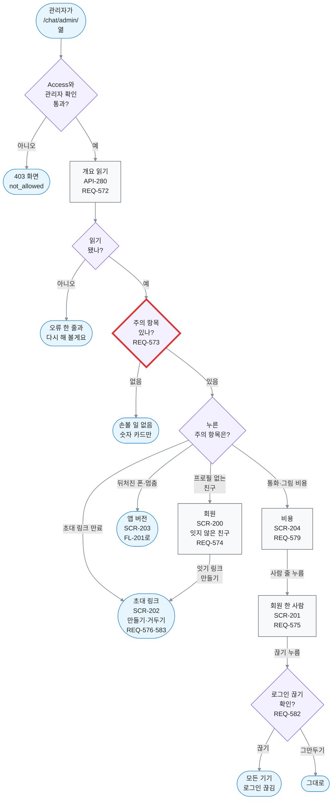

# FL-200 관리 페이지 개요에서 손볼 일 처리하기

Serves: REQ-570, REQ-571, REQ-572, REQ-573, REQ-574, REQ-575, REQ-576, REQ-579, REQ-582, REQ-583
Screens: SCR-169, SCR-200, SCR-201, SCR-202, SCR-203, SCR-204
Context: CTX-026, CTX-029, CTX-006, CTX-031, CTX-021
상태: active(2026-11-23 체크포인트 통과, D135). 처음 초안은 2026-11-23 KST, Claude 마롱이 봇. 2026-11-24 기능 변경 4로 메모 줄의 탭 목록에 '업데이트 내역'을 더했어요(D173 4-4, 그림의 칸과 화살표는 그대로, 바뀌기 전 글은 [기능 변경 목록 4](../02-prd/admin-changelog.md#기능-변경-목록-4승인된-항목이-바뀌는-곳)).

| Shape | Means |
| --- | --- |
| Rectangle | 서버나 화면이 하는 한 단계 |
| Diamond | 분기. 나가는 선마다 이름이 있어요 |
| Stadium | 흐름이 끝나는 곳(또는 다른 흐름으로 넘어감) |
| 빨간 굵은 테 | 이 흐름의 핵심 단계: 주의 항목이 있는지 |

관리 페이지를 열면 손볼 일(주의 항목)이 먼저 보이고, 한 줄을 누르면 그 일을 다루는 화면으로 바로 간다는 것을 보세요. 프로필 없는 친구는 회원 화면(SCR-200)으로 가서 '잇기 링크 만들기'로 초대 링크 화면에 이어져요. 아이템 화면은 주의 항목이 없어도 탭 줄(REQ-571)로 언제나 갈 수 있어서 그림에 따로 그리지 않았어요.

- 모든 화면 위에 탭 줄이 있어요: 개요 · 회원 · 초대 링크 · 앱 버전 · 비용 · 아이템 · 업데이트 내역(REQ-570·571). 아이템은 지금 화면 SCR-186 그대로예요(FL-192). 업데이트 내역은 FL-215예요(D173 4-4).
- 주의 항목의 조건과 문턱은 [요구사항 '시작 값'](../02-prd/admin.md#시작-값설정)에 있어요. 서버가 API-280에서 계산하고, 화면은 받은 줄을 차례대로 그려요.
- 회원 한 사람 화면(SCR-201)의 한도 바꾸기는 FL-179, 티켓 넣기는 FL-177의 관리자 쪽 그대로예요. 들어가는 화면만 바뀌어요(요구사항의 기능 변경 목록 8·9).
- 초대 링크 만들기는 FL-169·170·171 그대로이고 시작 화면이 초대 링크 화면(SCR-202)이에요. 거두기(REQ-583)는 질문 2의 답 '더함'(D137)으로 들어가요.
- 확인에 실패하면(Access 증명 없음, 관리자 아님) 어느 화면이든 같은 403이에요. 쓰기 요청이 다른 주소에서 오면 403 `cross_site`이고 화면은 공통 오류 줄을 보여요.
