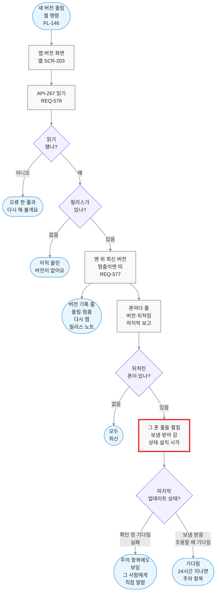

# FL-201 새 버전을 올린 뒤 폰들이 받는지 보기

Serves: REQ-577, REQ-578, REQ-573
Screens: SCR-203, SCR-169
Context: CTX-021(읽기만)
상태: 초안(2026-11-23 KST, Claude 마롱이 봇). proposed예요. 읽는 값의 형식은 모두 API-267(PR #101, SPEC-438, 기능 명세 8.6)이 정하고 이 흐름은 바꾸지 않아요.

| Shape | Means |
| --- | --- |
| Rectangle | 화면이 하는 한 단계 |
| Diamond | 분기. 나가는 선마다 이름이 있어요 |
| Stadium | 흐름이 끝나는 곳 |
| 빨간 굵은 테 | 이 흐름의 핵심 단계: 한 폰의 업데이트 기록을 펼쳐 보기 |

새 버전을 올린 뒤 동희님이 볼 곳은 폰마다의 줄이고, 뒤처진 폰은 펼쳐서 보냄부터 설치까지 어디서 멈췄는지 본다는 것을 보세요. 버전 기록과 폰 줄은 같은 응답에서 나란히 그려요.

- 화면은 API-267 하나만 불러요. 릴리스를 올리거나 멈추거나 다시 켜는 단추는 없어요(REQ-578). 그 일은 지금처럼 노트북의 셸 명령이에요(FL-146).
- 폰 줄의 이름은 API-267의 친구 이름과 폰 순번이에요(설치 ID 대신). 사람은 친구 ID `friendId`로 구분해요(이름이 같은 두 친구는 '현경(7)'처럼 번호를 붙임). 폰은 친구마다 최근 20대, 모두 200대, 받아 감은 100명까지 오고, 상한에 닿으면 화면이 알려요(PR #101 SPEC-438). 업데이트 기록 줄의 종류는 보냄(`pushed`)·보내기 실패(`push_failed`)·상태(`state`: 받음, 조용할 때 기다림, 확인 창 기다림, 실패)·설치됨(`installed`)이고, 받아 감(`fetched`)은 친구마다 따로 와요. 화면은 받아 감을 그 친구의 폰 줄 아래에 함께 보여요.
- '확인 창 기다림'은 안드로이드가 사람의 확인을 요구하는 상태라, 화면 밖에서 그 사람에게 앱을 열어 '지금 설치'를 눌러 달라고 말하는 것이 다음 일이에요. 화면은 그 안내 한 줄만 보여요.
- 24시간은 주의 항목의 시작 값이에요(새 제안).
