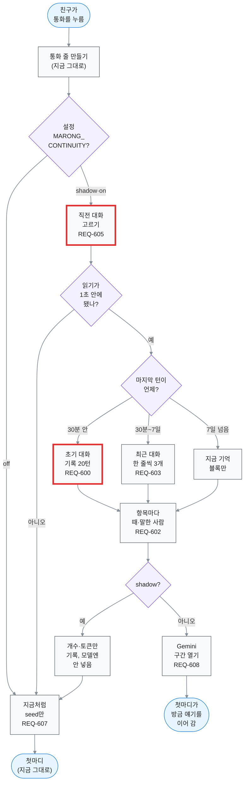

# FL-210 통화를 열 때 직전 대화 잇기

Serves: REQ-600, REQ-602, REQ-603, REQ-604, REQ-605, REQ-606, REQ-607, REQ-608, REQ-611, REQ-612
Screens: 통화 홈 SCR-001, 통화 중 SCR-002(화면은 바뀌지 않음)
Context: CTX-002, CTX-004
Follows: FL-002(통화하기)의 '통화 연결' 단계 안에서 일어나요. FL-002는 고치지 않아요.
Status: proposed(2026-11-24, [01 도메인](../01-domain/continuity.md))

| Shape | Means |
| --- | --- |
| Stadium | 흐름이 시작하거나 끝나는 곳 |
| Rectangle | 통화 서버가 하는 한 단계 |
| Diamond | 분기. 나가는 선마다 이름이 있어요 |
| 빨간 굵은 테 | 이 흐름의 핵심 단계: 직전 대화 고르기와 초기 대화 기록 |

그림: 설정이 `on`이고 직전 대화가 30분 안에 끝났으면 실제 턴이 초기 대화 기록으로 들어가요(빨간 테두리). 읽기가 실패하거나 1초를 넘기면 지금처럼 시작해요. 친구가 "우리 아까 무슨 얘기 했지?"라고 물으면 마롱이가 그 기록으로 답해요(단계 8).

## 단계

| 단계 | 누가 | 무엇 | REQ |
| --- | --- | --- | --- |
| 1 | 친구 | 통화 홈에서 통화를 눌러요(앱 벨을 받은 통화도 같아요) | — |
| 2 | 통화 서버 | 통화 줄을 만들고, 설정이 `off`가 아니면 직전 대화를 골라요. 그 친구의 1:1 글(묶인 단체방 빼고)과 그 친구의 이 통화가 아닌 통화만 읽어요 | REQ-605, REQ-607 |
| 3 | 통화 서버 | 마지막 턴이 30분 안이면 그 대화의 마지막 20턴(2,000자)을 초기 대화 기록으로 준비해요. 30분\~7일이면 최근 대화 3개를 한 줄씩, 7일이 넘으면 지금 기억 블록만 써요 | REQ-600, REQ-603 |
| 4 | 통화 서버 | 기억 블록의 항목마다 말한 사람과 상대 시각 표기를 붙여요. 마롱이의 마지막 말에 답이 없으면 '답 없음' 표시를 붙여요 | REQ-602, REQ-604 |
| 5 | 통화 서버 | 통화에는 친구 목록을 이름과 관계만 넣고, 지시문에 '먼저 꺼내지 않기' 줄을 넣어요 | REQ-606, REQ-611 |
| 6 | 통화 서버 | 지금 구간 설정(압축 값, SPEC-489)으로 Gemini 구간을 열고, 준비가 끝나면 초기 대화 기록을 보낸 다음에 화면·앱에 준비됨(`ready`)을 알려요. 화면은 그때 지금처럼 인사 신호를 보내요 | REQ-600, REQ-608, REQ-612 |
| 7 | 마롱이 | 첫마디에 방금 하던 얘기를 자연스럽게 이어요. 예: "아까 부산 얘기하다 끊겼지?" | REQ-600 |
| 8 | 친구 | "우리 아까 무슨 얘기 했지?"라고 물으면 마롱이가 직전 대화로 답해요 | REQ-600 |

## 예외

| 경우 | 어떻게 |
| --- | --- |
| 직전 대화를 읽다 DB 오류·1초 넘김 | 직전 대화 없이 지금처럼 열어요. 경고 로그 1줄(개수·오류 이름만) |
| 설정 `shadow` | 2\~5단계를 하고 개수·글자 수·걸린 시간만 기록해요. 모델에는 지금과 같은 것만 보내요 |
| Vertex가 초기 대화 기록 설정을 거절(`setup_rejected`) | 그 통화는 초기 대화 기록 없이 다시 열고, 3단계의 턴을 지시문의 기억 블록에 글로 넣어요(SPEC-481 예외) |
| 같은 통화의 재연결·미리 넘기기·이어 받은 통화 | 다시 잇기 핸들이 있으면 보내지 않아요. 핸들 없이 새 구간을 열면 그때 직전 대화를 다시 골라 보내고, 닫는 `[알림]`은 '지금 통화는 이어지는 중이니 인사하지 마'예요. 이번 통화 자막은 지금처럼 seed의 `current_call`로 가요 |
| 마롱이가 먼저 건 통화(벨·선 전화) | 같아요. 약속·화두 구간은 지금 그대로 지시문에 있어요 |
| 통화 중에 친구가 그 얘기를 잊어 달라고 함 | 지금 잊기 규칙 그대로예요. 핸들을 버리고 여는 다음 구간에서 다시 골라서 잊기 표시된 줄이 빠져요 |
| 긴 통화에서 압축이 걸림 | 가장 오래된 턴부터 잘려서 초기 대화 기록이 먼저 빠져요. 압축 값은 SPEC-489로 정해요 |
| 디스코드 음성 통화 | 같은 통화 서버 경로라 같아요. 디스코드 서버 채널의 다른 사람 말은 범위 밖이라 들어가지 않아요(REQ-605) |
