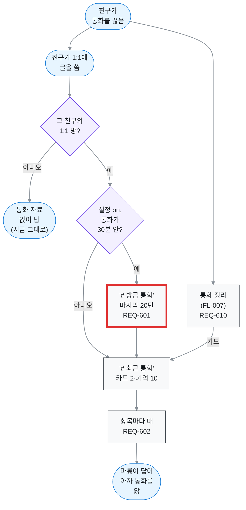

# FL-211 통화 뒤 글 대화로 잇기

Serves: REQ-601, REQ-602, REQ-605, REQ-607, REQ-610
Screens: 글 대화 SCR-107(화면은 바뀌지 않음), 카카오·디스코드 1:1 방
Context: CTX-001, CTX-004
Follows: FL-007(끊기와 정리), FL-010(카톡 마롱이가 통화를 앎). 두 흐름은 고치지 않아요.
Status: proposed(2026-11-24, [01 도메인](../01-domain/continuity.md))

| Shape | Means |
| --- | --- |
| Stadium | 흐름이 시작하거나 끝나는 곳 |
| Rectangle | 앱 서버(정리는 정리기)가 하는 한 단계 |
| Diamond | 분기. 나가는 선마다 이름이 있어요 |
| 빨간 굵은 테 | 이 흐름의 핵심 단계: '# 방금 통화' 넣기 |

그림: 통화가 끝난 지 30분 안에 친구가 1:1 글을 쓰면 '# 방금 통화' 블록(빨간 테두리)이 지금의 '# 최근 통화' 앞에 들어가요. 정리는 끊은 뒤 따로 돌아서(2분 안), 정리가 아직이어도 '# 방금 통화'는 자막에서 바로 읽어요.

## 단계

| 단계 | 누가 | 무엇 | REQ |
| --- | --- | --- | --- |
| 1 | 친구 | 통화를 끊어요. 정리기는 지금처럼 따로 돌아요 | REQ-610 |
| 2 | 친구 | 30분 안에 1:1 글 대화(앱·웹·디스코드 DM·카카오 1:1)에 글을 써요 | — |
| 3 | 앱 서버 | 그 방이 그 친구의 통화 기억 범위 방이면, 가장 최근에 끝난 통화가 30분 안인지 봐요 | REQ-605 |
| 4 | 앱 서버 | 30분 안이면 그 통화의 마지막 20턴(2,000자)을 '# 방금 통화'로 넣어요. 지금의 '# 최근 통화'(카드 2·기억 10)는 그대로 넣고 항목마다 때를 붙여요 | REQ-601, REQ-602 |
| 5 | 마롱이 | "아까 통화에서 부산 간다고 했잖아"처럼 이어서 답해요 | REQ-601 |

## 예외

| 경우 | 어떻게 |
| --- | --- |
| 통화 자막 읽기 실패·1초 넘김 | 블록 없이 답해요(지금 SPEC-024와 같음) |
| 단체방, 다른 친구의 1:1 | 블록 없음 |
| 통화가 아직 `live`·`resting` | 끝난 통화만 읽어요. 지금 통화 중인 줄은 넣지 않아요 |
| 통화를 지움, 잊기 표시 | 그 줄은 바로 빠져요 |
| '# 방금 통화'를 넣은 뒤의 요약·메모 | 지금 `call.kakao_guards` 규칙 그대로, 그 뒤 방의 자료는 비공개로 표시돼서 공유 메모로 가지 않아요(REQ-044) |
