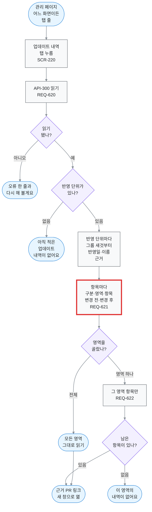

# FL-215 업데이트 내역 보기

Serves: REQ-620, REQ-621, REQ-622
Screens: SCR-220
Context: CTX-026(관리자 화면 TERM-176, 읽기만)
상태: proposed(2026-11-24 KST, Claude, 체크포인트 전). 관리 페이지 기능 변경 '업데이트 내역'([도메인](../01-domain/admin-changelog.md), D170·D171).

| Shape | Means |
| --- | --- |
| Rectangle | 화면이 하는 한 단계 |
| Diamond | 분기. 나가는 선마다 이름이 있어요 |
| Stadium | 흐름이 시작하거나 끝나는 곳 |
| 빨간 굵은 테 | 이 흐름의 핵심 단계: 항목마다 변경 전과 변경 후를 나눠 읽기 |

관리자가 보는 곳은 반영 단위 그룹 아래의 항목 줄이고, 항목마다 변경 전과 변경 후를 나란히 읽는다는 것을 보세요. 영역 고르기는 같은 응답을 화면에서 거르는 것이라 서버를 다시 부르지 않아요.

- 화면은 API-300 하나만 불러요. 쓰기 단추는 없어요(내역은 반영 절차가 저장소에서 써요, FL-216).
- 반영일이 '기록 없음'인 지난 단위는 단위 이름 앞 날짜의 자리에 놓여요(명세 SPEC-501).
- 근거 링크는 공개 저장소의 PR 주소예요(`https://github.com/kodonghui/marong2/pull/<번호>`). 커밋 근거는 커밋 주소예요. 새 창으로 열고 관리 페이지는 그대로예요.
- 읽지 못한 내역 파일이 있으면(형식이 틀림) 맨 위에 그 개수만 회색 글로 보이고 나머지는 그대로 그려요(SCR-220#skipped).
