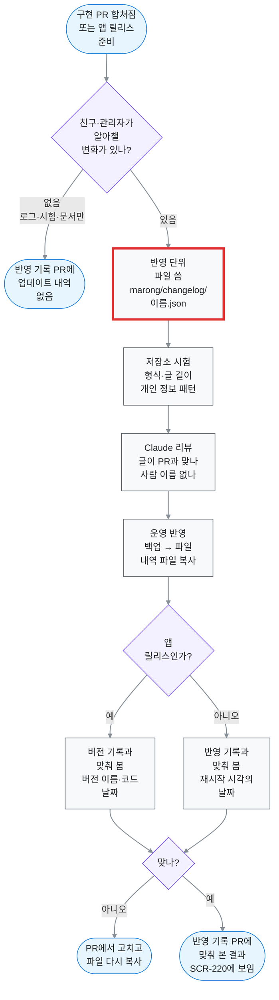

# FL-216 반영 때 업데이트 내역 쓰기

Serves: REQ-623, REQ-625
Screens: 없음(저장소 PR과 운영 서버의 반영 절차). 결과는 SCR-220에서 보여요
Context: 반영 절차(AGENTS.md, 제품 밖), CTX-021(앱 버전 기록은 맞춰 보기만)
상태: active(2026-11-24 체크포인트 통과, D172, 쓰는 쪽과 때는 D179). 처음 초안은 같은 날 KST, Claude. 하는 쪽은 반영하는 쪽(GPT, AGENTS.md D60·D65)이고 리뷰는 Claude예요(AGENTS.md 'PR 리뷰').

| Shape | Means |
| --- | --- |
| Rectangle | 반영하는 쪽이나 리뷰가 하는 한 단계 |
| Diamond | 분기. 나가는 선마다 이름이 있어요 |
| Stadium | 흐름이 시작하거나 끝나는 곳 |
| 빨간 굵은 테 | 이 흐름의 핵심 단계: 반영 전에 그 반영 단위의 파일을 씀 |

내역 파일은 반영 전에 PR에서 쓰고 검토받으며, 반영 때는 그 파일 하나만 서버 폴더에 더한다는 것을 보세요. 맞춰 보기가 실패하면 PR에서 고친 뒤 같은 파일을 다시 복사해요.

- 파일 이름(`id`)은 서버면 PR에서 정한 `<반영할 날>-<이름>`이고, 반영 때 반영 폴더를 그 이름으로 만들어요(`~/marong-deploy/<id>/`, `mktemp`면 뒤에 `.XXXXXXXX`). 앱이면 `app-<버전 이름>`이에요(TERM-271, SPEC-500·503).
- 반영일은 서버면 `put`이 복사한 시각(재시작 바로 뒤), 앱이면 게시 시각의 한국 시각 날짜예요. 지난 내역은 반영 기록의 재시작·게시 시각이라 폴더 이름의 날짜와 다를 수 있어요(예: `20261119-app-release-code7`은 2026-11-18 23:53 KST).
- 운영의 내역 폴더는 `/opt/marong-app/marong/changelog/`예요(앱 서버 코드 자리, 2026-11-24 읽어서 확인). 앱 서버는 요청마다 폴더를 읽어서 재시작이 필요 없어요(SPEC-501).
- 되돌리기 스크립트는 그 반영 단위 파일을 지워요. 다른 단위의 파일은 건드리지 않아요(SPEC-503).
- 내역 글에는 대화 내용, 실제 친구 이름, 이메일, 설치 ID, 키·토큰을 쓰지 않아요(REQ-625). 실제 사람은 '친구'라고 적어요.
