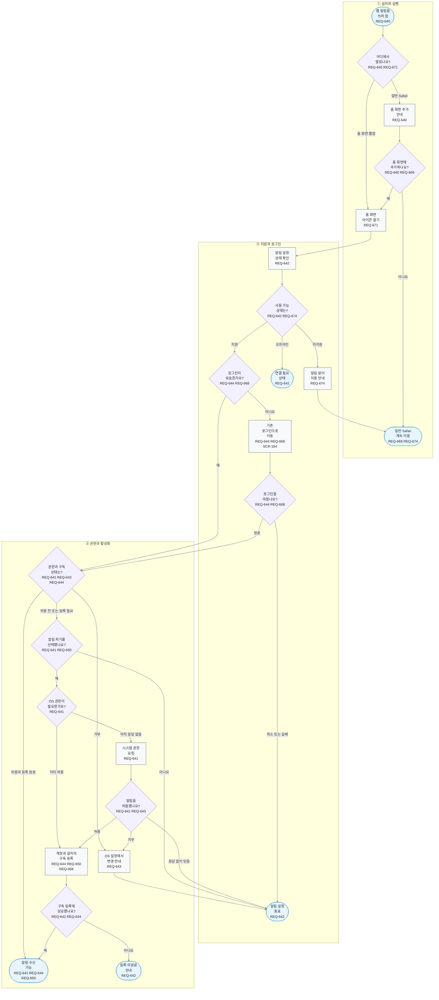

# FL-220 아이폰 홈 화면에 추가하고 알림 허용

03단계 초안 · CTX-026 · [02 고정 요구사항](../02-prd/iphone-home-webapp-notifications-version-candidate.md)

연결 요구사항 REQ-640, REQ-641, REQ-642, REQ-643, REQ-644, REQ-650, REQ-668, REQ-669, REQ-671, REQ-674.

일반 Safari에서는 설치를 안내합니다. 지원되는 홈 화면 웹앱에서 로그인한 사용자가 알림을 선택할 때만 권한 요청으로 이어집니다.

| 기호 | 의미 |
| --- | --- |
| 둥근 상자 | 시작 또는 종료 상태 |
| 사각형 | 사용자 동작 또는 시스템 처리 |
| 마름모 | 관찰 결과나 사용자 선택 |
| 실선 화살표 | 다음 단계 또는 종료 상태 |

## 기존 흐름과의 차이

[FL-169](FL-169-invite-join.md)·[FL-171](FL-171-add-device.md)의 가입·로그인을 사용합니다. [SPEC-396](../04-functional-spec/unified.md)의 manifest와 기존 홈 화면 아이콘 진입을 이어 가며 권한 허용 흐름을 추가합니다. 기존에 추가한 아이콘과 새 아이콘, 설치 전후 로그인 상태는 실기기에서 각각 확인합니다.

## 확인 조건

권한 허용과 서버 구독 등록 성공은 다른 상태입니다. 이미 거부한 사용자는 OS 설정에서 권한을 바꿀 수 있고, 기존 웹 이용은 [FL-227](FL-227-iphone-safari-use-draft.md)로 이어집니다. 미지원 여부를 결정할 최소 iOS 버전과 감지 방법은 04·06에서 정합니다.
