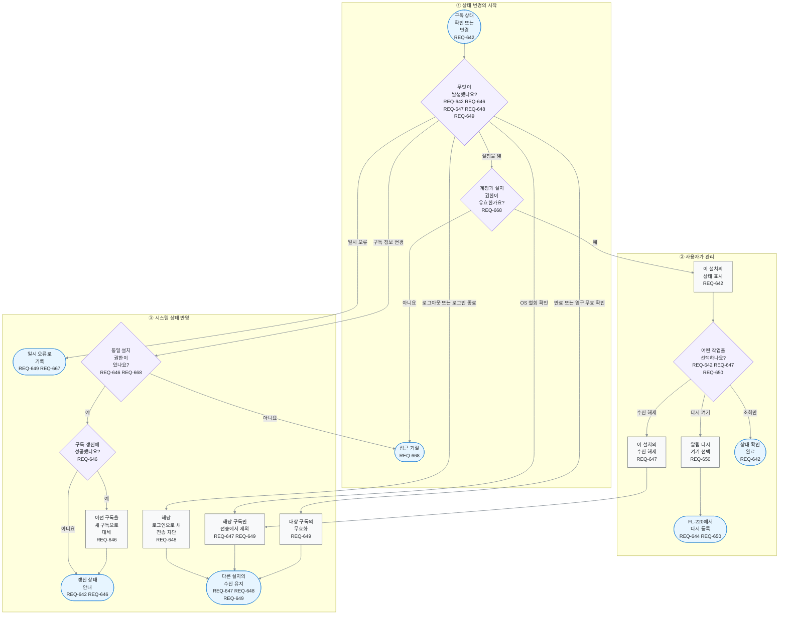

# FL-221 웹 알림 구독 확인·변경·해제

03단계 초안 · CTX-026 · [02 고정 요구사항](../02-prd/iphone-home-webapp-notifications-version-candidate.md)

연결 요구사항 REQ-642, REQ-644, REQ-646, REQ-647, REQ-648, REQ-649, REQ-650, REQ-667, REQ-668.

사용자가 구독을 관리할 때는 현재 계정과 설치를 확인합니다. 철회, 로그인 종료, 영구 무효는 해당 구독만 새 전송에서 제외합니다.

| 기호 | 의미 |
| --- | --- |
| 둥근 상자 | 시작 또는 종료 상태 |
| 사각형 | 사용자 동작 또는 시스템 처리 |
| 마름모 | 관찰 결과나 사용자 선택 |
| 실선 화살표 | 다음 단계 또는 종료 상태 |

## 기존 흐름과의 차이

[FL-171](FL-171-add-device.md)의 로그인 경로와 [SPEC-371·374](../04-functional-spec/unified.md)의 계정 확인을 사용합니다. Android 기기 보고·FCM 등록 해제와 별개로 웹 구독의 상태를 다룹니다. [Android 상태 보고 FL-194](FL-194-app-update-report.md) · [FCM 등록 해제 요구사항](../02-prd/fcm-unregistered.md)

## 확인 조건

설정에서 해제를 마쳤거나 웹이 OS 권한 철회를 확인한 뒤에는 해당 웹앱의 새 전송을 막습니다. 이미 공급자에게 전달된 알림을 회수하는 동작은 전제하지 않습니다. 알림을 다시 누르면 [글 FL-223](FL-223-iphone-open-message-notification-draft.md) 또는 [전화 FL-225](FL-225-iphone-answer-call-notification-draft.md)에서 로그인·계정을 검증합니다. 영구 무효와 일시 오류의 판정, 갱신 실패 뒤 기존 구독의 유효성 판단은 계약 단계로 넘깁니다.
