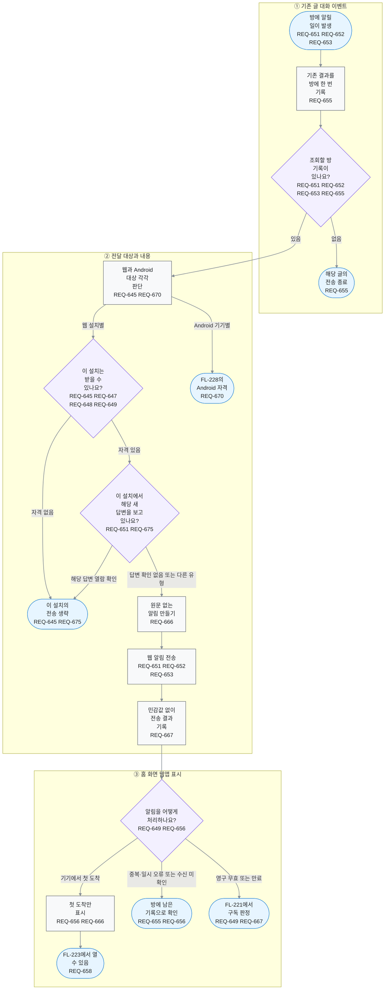

# FL-222 새 답변·선톡·일정 알림 받기

03단계 초안 · CTX-001·026 · [02 고정 요구사항](../02-prd/iphone-home-webapp-notifications-version-candidate.md)

연결 요구사항 REQ-645, REQ-647, REQ-648, REQ-649, REQ-651, REQ-652, REQ-653, REQ-655, REQ-656, REQ-658, REQ-666, REQ-667, REQ-670, REQ-675.

방 기록은 발생한 이벤트당 한 번입니다. 읽고 있다고 확인된 바로 그 설치의 새 답변만 생략하며 다른 기기의 자격과 기록은 별도로 처리합니다.

| 기호 | 의미 |
| --- | --- |
| 둥근 상자 | 시작 또는 종료 상태 |
| 사각형 | 사용자 동작 또는 시스템 처리 |
| 마름모 | 관찰 결과나 사용자 선택 |
| 실선 화살표 | 다음 단계 또는 종료 상태 |

## 기존 흐름과의 차이

[FL-176](FL-176-web-inbox.md)과 [SPEC-383](../04-functional-spec/unified.md#38-디스코드-없는-보내기-경로spec-383)의 방 기록 경로를 사용합니다. REQ-462 범위 안에서 새 답변·선톡·일정의 웹 알림을 추가합니다. [SPEC-119·120](../app-chat.md)의 Android 글 알림도 기존 자격을 적용합니다.

## 확인 조건

발생 이벤트와 방 기록을 새 스케줄러에서 다시 만들 필요가 없습니다. 유효한 동일 계정·로그인·허용 확인은 설치별로 적용합니다. 푸시 요청 결과와 기기 표시 여부는 따로 검증합니다. 알림 전송에 실패해도 기존 방 기록을 조회할 수 있습니다. 기본 미리보기에는 대화 원문이나 일정 제목이 없습니다. 전송 결과 기록에는 대화 원문·개인 식별값·구독 원본이 없습니다.
