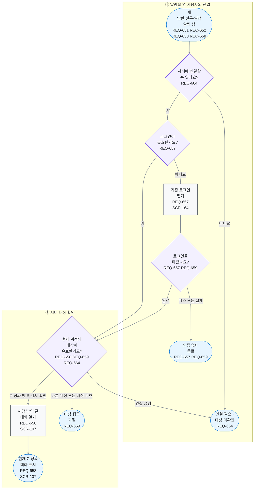

# FL-223 글 알림을 눌러 해당 방 열기

03단계 초안 · CTX-001·026 · [02 고정 요구사항](../02-prd/iphone-home-webapp-notifications-version-candidate.md)

연결 요구사항 REQ-651, REQ-652, REQ-653, REQ-657, REQ-658, REQ-659, REQ-664.

글 알림을 눌러도 계정, 방, 메시지의 접근을 확인해야 대화를 열 수 있습니다. 오프라인에서는 서버가 확인할 때까지 내용을 표시하지 않습니다.

| 기호 | 의미 |
| --- | --- |
| 둥근 상자 | 시작 또는 종료 상태 |
| 사각형 | 사용자 동작 또는 시스템 처리 |
| 마름모 | 관찰 결과나 사용자 선택 |
| 실선 화살표 | 다음 단계 또는 종료 상태 |

## 기존 흐름과의 차이

[FL-176](FL-176-web-inbox.md)은 사용자가 웹을 직접 열면 안 읽은 글을 보여 줍니다. 이 흐름은 보낸 알림에서 같은 기존 방으로 들어오는 경로를 추가합니다. 로그인 만료는 [FL-171](FL-171-add-device.md), Android 알림 누르기는 기존 [SPEC-122·146](../app-chat.md)을 사용합니다.

## 확인 조건

알림에 들어 있는 정보만으로 대화 내용은 공개되지 않습니다. 다른 계정으로 로그인하거나 대상이 없어진 경우에는 방이나 메시지 내용을 노출하지 않습니다. 연결 뒤 다시 열면 로그인·대상 확인을 새로 합니다. 방 안에서 대상 글을 어디에 표시할지는 03의 이동 의미를 유지하며 08에서 정합니다.
