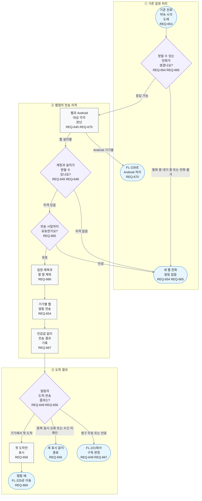

# FL-224 유효한 약속 전화 알림 받기

03단계 초안 · CTX-020·002·026 · [02 고정 요구사항](../02-prd/iphone-home-webapp-notifications-version-candidate.md)

연결 요구사항 REQ-645, REQ-648, REQ-649, REQ-654, REQ-656, REQ-660, REQ-665, REQ-666, REQ-667, REQ-670.

기존 약속 전화 한 건에 대해 웹앱의 전송 자격과 기한을 확인합니다. 알림이 도착해도 통화 수락은 시작되지 않습니다.

| 기호 | 의미 |
| --- | --- |
| 둥근 상자 | 시작 또는 종료 상태 |
| 사각형 | 사용자 동작 또는 시스템 처리 |
| 마름모 | 관찰 결과나 사용자 선택 |
| 실선 화살표 | 다음 단계 또는 종료 상태 |

## 기존 흐름과의 차이

[기존 약속 전화 FL-110·111](../app-ring.md#3-사용자-흐름-03)과 [FL-176](FL-176-web-inbox.md)의 유효한 벨을 재사용합니다. 알림을 받을 수 있는 홈 화면 웹앱으로만 웹 전송을 추가합니다. 선 전화 [FL-142](FL-142-hello-call.md)는 기존 정책 범위입니다.

## 확인 조건

웹 전송 전에 이미 만료됐으면 새 전화 알림은 0건입니다. 공급자에게 건넨 뒤 늦게 도착한 알림은 [FL-225](FL-225-iphone-answer-call-notification-draft.md)에서 현재 상태를 다시 봅니다. 벨의 응답 기한 숫자와 같은 전화의 전송별 정책은 기술 계약으로 남깁니다.
