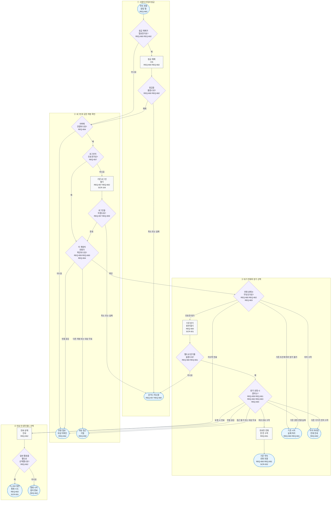

# FL-225 홈 화면 웹앱 전화 알림을 눌러 받기

03단계 초안 · CTX-002·020·026 · [02 고정 요구사항](../02-prd/iphone-home-webapp-notifications-version-candidate.md)

연결 요구사항 REQ-657, REQ-659, REQ-660, REQ-661, REQ-662, REQ-663, REQ-664.

알림 탭은 계정과 전화 상태를 확인하는 진입입니다. 약속 전화는 별도 받기 선택에서 한 번 수락하고, 만료된 전화는 일반 통화를 별도로 선택했을 때만 연결합니다.

| 기호 | 의미 |
| --- | --- |
| 둥근 상자 | 시작 또는 종료 상태 |
| 사각형 | 사용자 동작 또는 시스템 처리 |
| 마름모 | 관찰 결과나 사용자 선택 |
| 실선 화살표 | 다음 단계 또는 종료 상태 |

## 기존 흐름과의 차이

[FL-111의 기존 받기](../app-ring.md#3-사용자-흐름-03)와 [일반 통화 FL-002](FL-002-call.md)를 연결합니다. e2412 및 02 승인 A·C에 따라 웹앱 알림 진입의 만료 처리만 기존 SPEC-135의 일반 통화 전환과 달라집니다. 직접 들어온 기존 웹과 Android의 받기 동작은 기존 흐름을 씁니다.

## 확인 조건

① 잠금 해제 도중 만료와 ② 같은 계정으로 재로그인 도중 만료는 각각 계정 확인 뒤 만료로 표시합니다. ③ 유효한 받기 화면을 열었어도 받기 요청이 도착할 때 만료됐으면 수락과 일반 통화 자동 시작은 각각 0건입니다. ④ 다른 기기가 먼저 수락했으면 만료가 아닌 처리된 상태를 표시하며 추가 수락과 일반 통화 자동 시작은 0건입니다. 오프라인에서 다시 시도할 때는 계정과 응답 기한을 다시 확인합니다. 기존 마이크 권한과 연결 실패는 기존 통화 경로에서 다룹니다. 요청·수락 판정과 유효 시간, 버튼의 배치는 각각 04·06과 08에서 정합니다.
