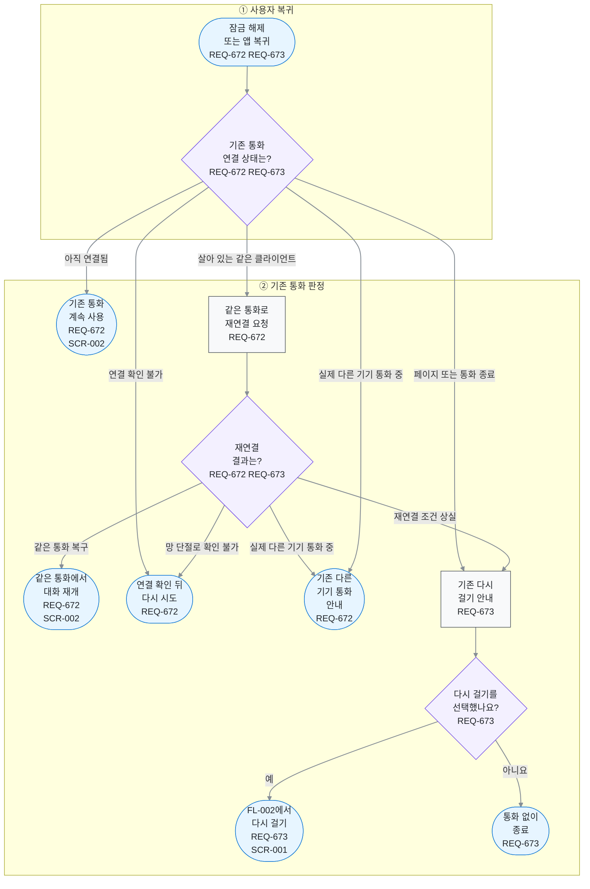

# FL-226 잠금이나 앱 전환 뒤 통화로 돌아가기

03단계 초안 · CTX-002 · [02 고정 요구사항](../02-prd/iphone-home-webapp-notifications-version-candidate.md)

연결 요구사항 REQ-672, REQ-673.

현재 연결이 살아 있으면 이어서 쓰고, 재연결 가능한 같은 클라이언트의 단절은 같은 통화로 복구합니다. 종료된 통화는 다시 걸기로 이어집니다.

| 기호 | 의미 |
| --- | --- |
| 둥근 상자 | 시작 또는 종료 상태 |
| 사각형 | 사용자 동작 또는 시스템 처리 |
| 마름모 | 관찰 결과나 사용자 선택 |
| 실선 화살표 | 다음 단계 또는 종료 상태 |

## 기존 흐름과의 차이

[FL-004](FL-004-reconnect.md)와 [SPEC-386](../04-functional-spec/unified.md#39-목소리와-동시-통화spec-385-spec-386)의 같은 클라이언트 재연결을 적용합니다. [BUG-114·TC-643](../12-qa/BUG-114-web-call-reconnect.md)의 알려진 회귀 검증을 일반 Safari와 홈 화면 웹앱에서 각각 확인합니다.

## 확인 조건

잠금·앱 전환·망 전환은 각각 시험합니다. 같은 클라이언트임을 확인할 수 있는 경우의 통화 ID와 양방향 오디오 성공을 기록합니다. 운영체제가 페이지를 닫거나 서버가 통화를 종료한 경우와 다른 기기가 실제 통화 중인 경우를 나눕니다. 이 흐름은 잠금 중 오디오 지속을 약속하지 않습니다.
