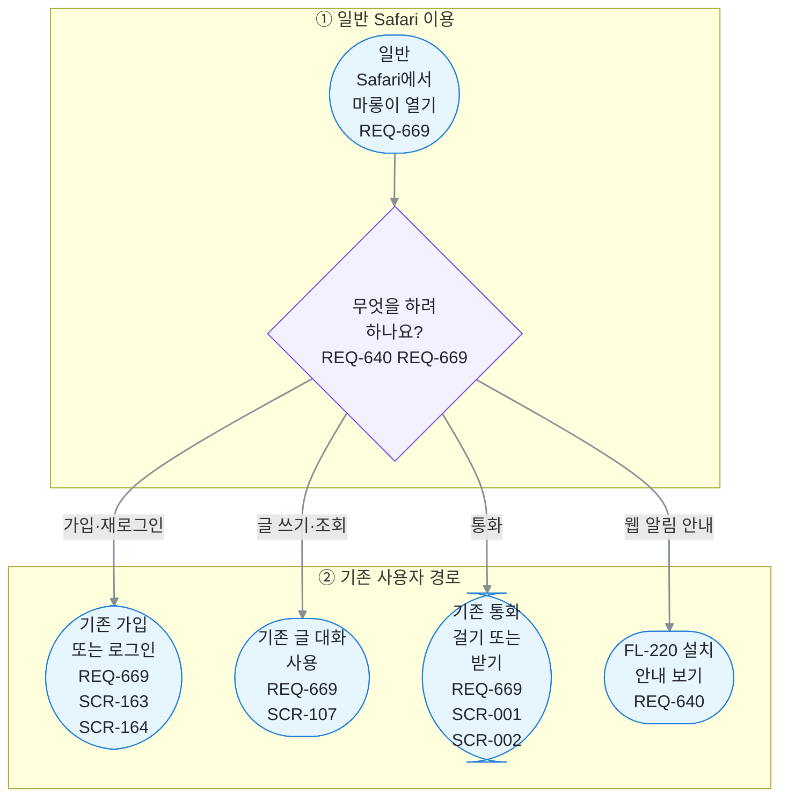

# FL-227 일반 Safari에서 기존 웹 기능 사용

03단계 초안 · CTX-001·002·026 · [02 고정 요구사항](../02-prd/iphone-home-webapp-notifications-version-candidate.md)

연결 요구사항 REQ-640, REQ-669.

일반 Safari에서는 기존 가입·글 대화·통화로 바로 들어갈 수 있습니다. 웹앱 설치와 알림 허용은 알림을 원할 때 선택합니다.

| 기호 | 의미 |
| --- | --- |
| 둥근 상자 | 시작 또는 종료 상태 |
| 마름모 | 관찰 결과나 사용자 선택 |
| 실선 화살표 | 다음 단계 또는 종료 상태 |

## 기존 흐름과의 차이

[FL-169](FL-169-invite-join.md)·[FL-171](FL-171-add-device.md)의 인증, [FL-176](FL-176-web-inbox.md)의 기존 방 조회, [FL-002](FL-002-call.md)의 전화 걸기를 회귀 확인합니다. 기존 웹을 직접 열었을 때 유효한 약속 전화 받기 버튼도 확인합니다. [기존 FL-111](../app-ring.md#3-사용자-흐름-03)

## 확인 조건

계정 인증·기존 마이크 권한·유효 시간은 기존 흐름을 따릅니다. 일반 탭에서 로그인·기기 코드·글 전송과 조회·통화 걸기·직접 받기가 가능한지 검증합니다. 아이폰 경로에서 잠금과 망 전환이 생긴 뒤에는 FL-226을 별도로 확인합니다.
